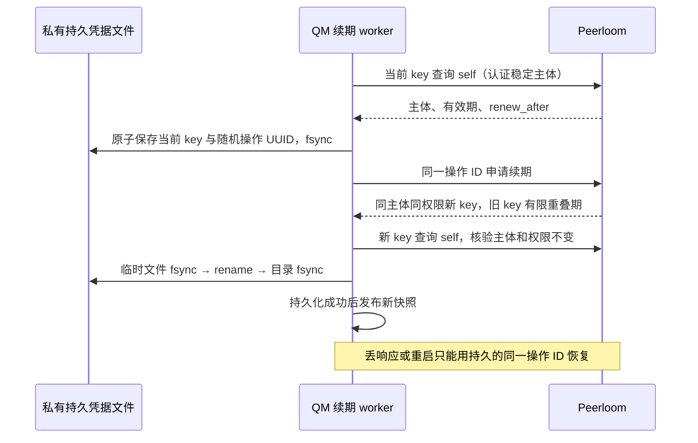

# QuickMirror app 模式业务服务

通用传输由 Peerloom 提供，本仓负责安装认证、持久设备绑定、能力目录与控制意图。项目聚合入口为 [qm-app](https://github.com/barry-ran/qm-app)，本仓不含客户端或 Peerloom 源码子模块。

## 当前架构

- 所有受保护请求直接校验 Peerloom 长期安装凭据；租户及 application 映射 PC/手机角色。不签发重复业务 token，也不保存安装秘密。
- 六位持久绑定码：PC 多手机、手机唯一 PC，双向添加、手机手动刷新、离线保留、批量逐项结果。
- PostgreSQL 事务保证关系唯一、退休码不复用、操作幂等和解绑关闭 outbox；未知结果不自动重发授权。
- 在线状态通过 Peerloom 公开 presence 查询，故障返回未知；手机能力快照不是上线证据。
- 控制意图固定 binding ID/版本，复用原独占槽位、runtime proof、generation 和 drain；解绑不跳过旧资源排空。

服务端实现、测试与正式发布/客户端联调是不同阶段。当前改造不能据此宣称新 SDK 发布、PC/安卓 UI 或真机投屏控制已全部通过。Core 媒体和 TCP 桥不属于这次身份绑定改造。

## 开发

```sh
go test -race ./...
go vet ./...
go build ./...
# 仅配置专用 *_test 数据库后运行
go test -race -tags integration ./internal/...
```

模块：`identity` 可信主体，`peerloom` 公开 API，`bootstrap` 注册授权，`catalog` 手机快照，`binding` 码和关系，`control` 会话授权及恢复，`httpapi` HTTP 边界。

参见 [文档入口](docs/README.md)、[部署](docs/部署指南.md)、[用户流程](docs/使用说明.md)及[绑定 OpenAPI](api/binding.openapi.json)。验证必须对应实际提交，不把旧版本或 mock 结果当新版本端到端证据。

需要验证真实源码服务间公开API时，参见[部署指南中的双服务隔离测试](docs/部署指南.md#云端源码双服务隔离测试)。该入口不连接现场，不等于正式SDK或真机验收。


## Peerloom 服务凭据自动续期

Linux/macOS 服务使用 `QM_PEERLOOM_SERVICE_CREDENTIAL_FILE` 指定绝对路径后，默认托管续期，无需另开开关或每月手动操作。初始文件可直接使用 `device-admin` 生成的 JSON，也接受单行凭据。QM 通过 Peerloom `GET /v1/service-credentials/self` 验证主体、租户、权限及期限，不相信文件中自报的身份元数据；租户和 PC/手机应用映射仍由 QM 的部署配置决定。

目录必须属于服务账号且权限为 `0700`，普通凭据文件为 `0600`，不接受末级符号链接和硬链接。JSON 总长不超过 16 KiB，secret 不超过 512 个可见 ASCII 字符。Docker **可写挂载专用父目录**，不要只挂单文件，也不要只读挂载。该目录同时保存凭据和续期操作标识，进程使用排他文件锁；第二个 writer 会启动失败。运行期间不要手工覆盖此托管文件。首次迁移请运行 `-migrate` 创建幂等域映射表，再启动服务；旧只读挂载必须先改成专用可写私有目录，否则服务明确启动失败。



Peerloom 当前默认期限 30 天，提前 7 天可续期，前后代最多重叠 24 小时；QM 按上游返回的 `renew_after` 触发，不硬编码续期日期。一个 worker 定期检查，暂时网络故障自动退避和重试，不阻塞请求线程，也不立即中断仍有效的会话。返回被撤销/失效时不能自动签发越权替代凭据。任何持久化失败都不发布新内存快照，不更换重试操作 ID；持久日志丢失或上游拒绝回放时必须明确报错，不能猜测或生成第二次续期绕过。

业务请求固定凭据快照，续期后新请求使用新 key。幂等域改用上游认证的稳定服务主体；首次启动仅将**当前已认证旧 key 的精确旧域**映射到新域，并事务写入数据库审计映射，不迁移无法证明所属主体的旧记录。Peerloom 同主体后继凭据可访问原幂等记录，既有绑定、grant 和会话不因 key 更新被清理。未曾持有的历史 key 域不会被猜测迁移。此能力要求 Peerloom 已支持服务主体和续期 API；旧上游会明确启动失败，而非假装自动续期。

`GET /healthz` 返回 `credential_status`，续期失败、持久化失败、即将到期或失效时返回 503；恢复成功自动回到健康。结构化日志仅记录事件类别、主体 ID、凭据 ID 和剩余秒数，不输出 secret 或上游响应正文。故障期间仍在有效期内的凭据可继续服务，但健康探针表示需关注，不应把所有 503 直接解释为必须重启进程。

原 `QM_PEERLOOM_SERVICE_CREDENTIAL` 是明确的 **legacy 静态模式，不自动续期**，与 FILE 互斥；健康状态为 `legacy_static`，不宣称具备自动维护能力。Windows 首版不支持托管 FILE，启动时明确拒绝；只支持 legacy 静态模式。正式自建部署使用 Linux 托管模式，无新增 UI 或外部通知渠道。
