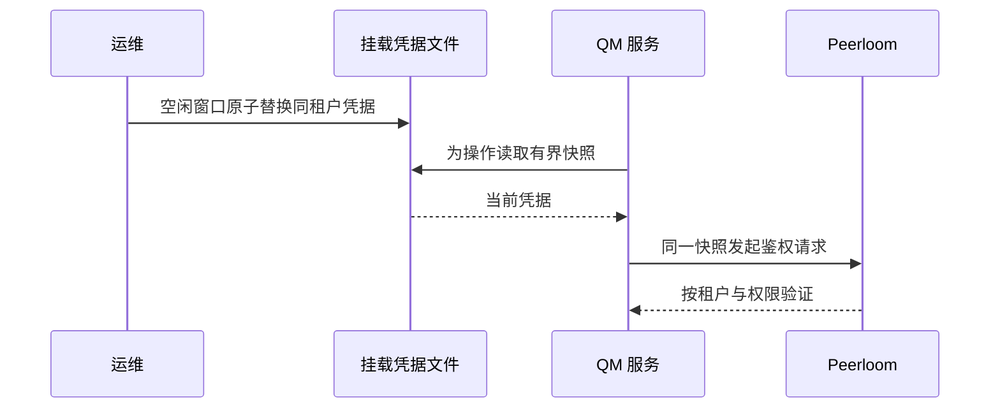

# QuickMirror app 模式业务服务

通用传输由 Peerloom 提供，本仓负责安装认证、持久设备绑定、能力目录与控制意图。项目聚合入口为 [qm-app](https://github.com/barry-ran/qm-app)，本仓不含客户端或 Peerloom 源码子模块。

## 当前架构

- 所有受保护请求直接校验 Peerloom 长期安装凭据；租户及 application 映射 PC/手机角色。不签发重复业务 token，也不保存安装秘密。
- 六位持久绑定码：PC 多手机、手机唯一 PC，双向添加、手机手动刷新、离线保留、批量逐项结果。
- PostgreSQL 事务保证关系唯一、退休码不复用、操作幂等和解绑关闭 outbox；未知结果不自动重发授权。
- 在线状态通过 Peerloom 公开 presence 查询，故障返回未知；手机能力快照不是上线证据。
- 控制意图固定 binding ID/版本，复用原独占槽位、runtime proof、generation 和 drain；解绑不跳过旧资源排空。

服务端实现、测试与正式发布/客户端联调是不同阶段。当前改造不能据此宣称新 SDK 发布、PC/安卓 UI 或真机投屏控制已全部通过。Core 媒体和 TCP 桥不属于这次身份绑定改造。

## 开发

```sh
go test -race ./...
go vet ./...
go build ./...
# 仅配置专用 *_test 数据库后运行
go test -race -tags integration ./internal/...
```

模块：`identity` 可信主体，`peerloom` 公开 API，`bootstrap` 注册授权，`catalog` 手机快照，`binding` 码和关系，`control` 会话授权及恢复，`httpapi` HTTP 边界。

参见 [文档入口](docs/README.md)、[部署](docs/部署指南.md)、[用户流程](docs/使用说明.md)及[绑定 OpenAPI](api/binding.openapi.json)。验证必须对应实际提交，不把旧版本或 mock 结果当新版本端到端证据。

需要验证真实源码服务间公开API时，参见[部署指南中的双服务隔离测试](docs/部署指南.md#云端源码双服务隔离测试)。该入口不连接现场，不等于正式SDK或真机验收。


## Peerloom 服务凭据文件与热轮换

可信业务后端可改用 `QM_PEERLOOM_SERVICE_CREDENTIAL_FILE`（绝对路径）读取单行服务凭据或 `device-admin` 输出 JSON 的 `service_credential` 字段；它与原 `QM_PEERLOOM_SERVICE_CREDENTIAL` 环境变量互斥。原环境变量模式仍兼容，但其值在启动时固定。首次切换配置仍须重启服务；文件模式启用后，新请求读取新的文件内容，无须再次重启。

文件必须是可信本地普通文件（不接受末级符号链接），凭据最多 512 个可见 ASCII 字符；单行格式可附一个 LF 或 CRLF，JSON 文件总长不超过 16 KiB。JSON 中其他元数据不替代 QM 配置的租户和应用 ID。父目录必须由可信运维控制，Linux/macOS 使用非阻塞且不跟随末级链接的打开方式，Windows 拒绝 UNC/设备路径并校验文件身份。读取有大小上限；缺失、空文件、非法内容或不可读会拒绝对应上游操作，不继续偷偷使用旧密钥、不在错误中输出文件内容。部署时限制文件及父目录访问，仅服务账号可读、运维账号可替换。Docker 应只读挂载父目录而非单文件，运维在同一目录准备新文件后原子替换，避免读到半写内容或挂载仍指向旧 inode。



此功能不签发新凭据、不自动续期、不扩大权限，也不撤销旧凭据。推荐在没有新注册或新建控制意图的空闲窗口轮换，并保留旧凭据有效到已在途请求排空。快照确保注册操作及控制 dispatch 的凭据与持久幂等域一致；同注册请求在换 key 后重试仍保守拒绝，同一 Create 调用跨持久化和 dispatch 保持快照；若 reserving 在进程中断后跨 key 恢复仍可能标记结果未知，不能承诺所有在途流程无感。不可把重试改成无条件重签。既有同租户 grant 查询、撤销与后续新操作使用新凭据，现有绑定不会因此被清理。
