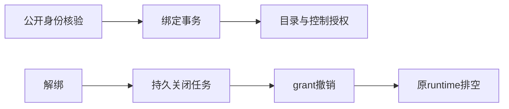

# app 模式开发与验收

以 qm-app 的身份认证与设备绑定改造方案及各子仓实际提交为准。先读 AGENTS、现有模块和测试，再改代码。Core TCP桥、解码/渲染/录制、无关UI不改；不增加账号、二维码、批准、限流或旧UUID添加兼容。

## 服务端交付

| 模块 | 验证边界 |
|---|---|
| 安装认证 | 每请求公开device-self核验租户/app；无业务token、秘密密文或续期定时器 |
| 安装初始化 | 两端幂等ensure；不覆盖绑定、码、boot/seq或权限快照 |
| 绑定 | 六位字符串、双向离线添加、手机唯一PC、PC多手机、刷新退休码不复用 |
| 幂等 | 同键同请求恢复；冲突拒绝；24h收据过期UNKNOWN，不重执行墓碑键 |
| 列表 | 自己关系、游标分页、独立presence、未知不伪造空列表 |
| 解绑控制 | 关系版本固定、grant前后复核、同事务关闭outbox、重启恢复及原runtime排空 |

## 执行检查

普通 `go test -race ./...`、`go vet ./...`、`go build ./...`；专用 `*_test` PostgreSQL运行 `go test -race -count=1 -tags integration ./internal/...`。`runtimeintegration`另用verify-full TLS数据库，正式Peerloom包测试使用独立release标签和隔离租户。必须区分编译通过、mock上游集成、正式SDK与真机结果。

## 跨仓交接

Peerloom先统一协议/五端SDK、正式发布和校验和；客户端消费发布包、删除exchange、实现列表和双向绑定交互。新ABI不可用时不得默默继续旧二进制。提交应列实际验证、未验证和阻塞；子仓先推送再更新聚合gitlink。临时服务器授权移除前仍需用户确认。不得提交现场凭据、数据、测试产物或日志。
