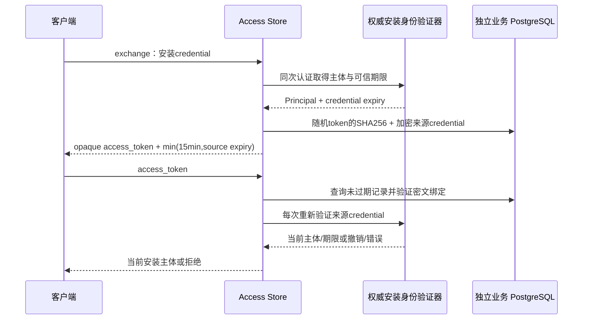

# 业务令牌模块

## 身份交换与逐请求重验

`internal/access` 使用严格公开 `CredentialVerifier` 适配器，运行时已挂载exchange与目录HTTP。依赖正式Peerloom服务端v0.1.3的 `device-self.credential_expires_at`，期限来自同次认证的数据库凭证行；缺少字段、无效期限、来源不可达均失败关闭。已用正式包完成真实公开接口与业务TLS运行时联调，没有生产mock放行开关。

原产品账号 token 不参与该模块。PC/mobile 角色必须来自权威 application 映射，不能信任客户端自报角色或期限。

## 设计

- token 为32字节密码学随机值，业务库只存SHA256；它不是可离线解码的 JWT。
- 来源安装 credential 使用 AES-256-GCM 密封。随机 nonce 与密文入库，AAD 绑定版本、服务域、token hash、完整主体及业务到期时间，防止把一条密文换到另一条身份/期限记录。随机96-bit nonce的同key加密次数由数据库原子计数，跨本数据库实例/服务域累计最多2^32次；用尽后拒绝新exchange，但不阻止仍有效token验证。这是密码学预算，不是设备数量上限；计数不随token清理删除，失败/结果未知的加密尝试不退款。
- 业务有效期不超过可信来源期限与数据库当前时间加15分钟中的较小值，精度统一为微秒。零期限不猜测，过期不签发。
- 每个受保护请求都会再次验证来源 credential，并要求主体完全匹配；上游不可达时返回不可确认，不凭缓存主体继续授权。来源凭证的刷新重叠、缩短或撤销不能由业务 token 延长。
- 查询在两次网络/数据库操作之间不是跨系统原子事务；这里保证每次请求进行权威校验，不承诺凭证在校验返回后永远不会被并发撤销。独占会话仍须依赖 Peerloom 的 epoch/租约，不能拿业务 token 替代它。

## 密钥和持久化边界

这是敏感数据存储边界，运行时通过 `QM_ACCESS_KEY_FILE` 读取运维提供的独立32字节key（标准base64文件），不自动生成或记录内容。本次开发未创建生产密钥、读取现有secret或让用户上传密钥；测试仅用隔离临时key与全新测试租户凭证。

key必须专供本模块，不得同时用于其他加密用途。相同key只能对应唯一的计数表：不得跨独立数据库或不同schema/search_path的计数表复用。预算占用事务强制本事务synchronous_commit=on，成功提交后才能加密；不修改数据库全局设置。数据库恢复或可能丢失已确认写入的故障切换后必须轮换key，避免回滚累计加密计数。单key设计下，更换key会使既有token无法解密；客户端必须使用自身仍有效的安装credential重新exchange。多实例必须使用同一受控key，轮换需要协调，不能让不同实例交替拒绝对方签发的token。未来如需平滑多key轮换，应单独设计key id与退役窗口，不能在解密失败时尝试明文或绕过校验。

到期记录由显式 `PurgeExpired` 清理。SQL删除不等于磁盘、WAL或备份的物理擦除：备份中可能保留加密来源credential，持有历史加密key的人仍可能解密。因此上线前必须审查备份保留、密钥管理和最小权限策略；不能把15分钟业务token期限误称为来源credential的密码学销毁期限。

源码不记录token、来源credential、nonce/密文或验证器内部错误。数据库role仅应访问本业务schema；Peerloom私有数据库仍不作为依赖。

## 当前验证

普通Go测试验证token规范编码和AAD篡改；真实PostgreSQL集成测试验证期限上界、密文存储、来源撤销/不可达/缺期限、角色与scope隔离、DB期限篡改、key轮换、加密预算跨重建保留/耗尽、验证等待中token到期、过期清理及32个并发exchange/verify。32是测试并发档位，不是运行数量上限。正式包公开接口与运行时联调已单独通过；这些不替代客户端身份持久化、独占会话或群控媒体验收。

## HTTP 编排

`httpapi.ExchangeHandler` 提供 PC `/qm/v1/auth/pc/exchange` 与手机 `/qm/v1/auth/device/exchange`。角色由路径固定，来源凭证仅从单个 Authorization Bearer 读取；正文可为空或 `{}`，不能提交 UUID、角色或期限。使用独立并发预算、10秒上下文期限、no-store及稳定中英文错误，不把内部错误或来源credential写回响应。

`ExchangeVerified` 同时返回本次已认证主体与业务token，不再发第二次认证请求猜测主体。手机用该主体调用目录 `EnsureRegistration`，确认后才返回token；再次交换不重置设备状态。token插入和目录建档不是一个跨模块原子事务，目录失败时已生成token不会返回，保留到显式过期清理；不能把这描述成跨服务exactly-once或即时撤销保证。PC不会创建手机目录。接口字段见[身份交换OpenAPI](../api/exchange.openapi.json)。

本地验证包括真实TLS HTTP与独立业务PostgreSQL的exchange→resolve→status→再次exchange保持状态→来源撤销拒绝链路；权威身份验证器在这组测试中明确是夹具。另有只针对全新回环正式Peerloom服务包的 `peerloom_release_integration` 测试入口；缺少显式隔离环境时只跳过，编译或跳过不算上游实际联调。正式v0.1.3公开包已实际通过该入口；另用 `runtimeintegration` 在正式Peerloom、verify-full业务PG、HTTPS运行时上完成真实exchange/目录/状态/重交换/角色拒绝/来源撤销测试。测试目录与进程独立，结束后回收自有进程和秘密输入，无生产部署。
