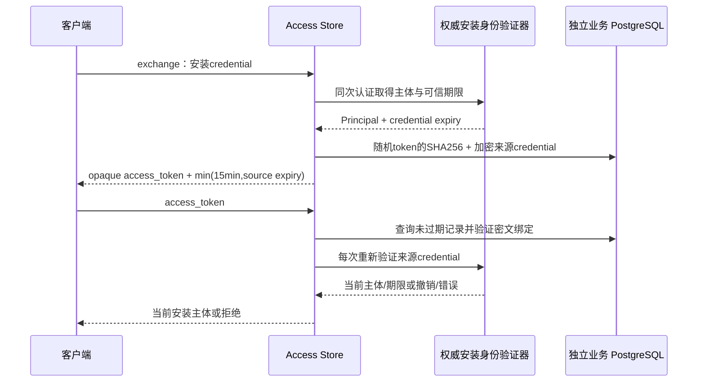

# 业务令牌模块

## 状态：内部草案，尚未接线

`internal/access` 是内部存储与验证边界，已准备严格 `CredentialVerifier` 草案适配器，但没有经已发布上游接口联调的生产适配器，也没有挂到 HTTP 服务。现有 Peerloom `device-self` 尚未返回本次安装凭证的可信到期时间；后续公开 `credential_expires_at` 扩展必须发布、核对并真实联调，才能完成 exchange。测试中的验证器只是假定权威服务的夹具，不是允许生产绕过身份的选项。

原产品账号 token 不参与该模块。PC/mobile 角色必须来自权威 application 映射，不能信任客户端自报角色或期限。

## 设计

- token 为32字节密码学随机值，业务库只存SHA256；它不是可离线解码的 JWT。
- 来源安装 credential 使用 AES-256-GCM 密封。随机 nonce 与密文入库，AAD 绑定版本、服务域、token hash、完整主体及业务到期时间，防止把一条密文换到另一条身份/期限记录。随机96-bit nonce的同key加密次数由数据库原子计数，跨本数据库实例/服务域累计最多2^32次；用尽后拒绝新exchange，但不阻止仍有效token验证。这是密码学预算，不是设备数量上限；计数不随token清理删除，失败/结果未知的加密尝试不退款。
- 业务有效期不超过可信来源期限与数据库当前时间加15分钟中的较小值，精度统一为微秒。零期限不猜测，过期不签发。
- 每个受保护请求都会再次验证来源 credential，并要求主体完全匹配；上游不可达时返回不可确认，不凭缓存主体继续授权。来源凭证的刷新重叠、缩短或撤销不能由业务 token 延长。
- 查询在两次网络/数据库操作之间不是跨系统原子事务；这里保证每次请求进行权威校验，不承诺凭证在校验返回后永远不会被并发撤销。独占会话仍须依赖 Peerloom 的 epoch/租约，不能拿业务 token 替代它。

## 密钥和持久化边界

这是新增的敏感数据存储设计，尚未配置到运行时。部署时需要受控32字节加密key；本次开发没有创建生产密钥、读取现有secret或让用户上传密钥。测试用固定无效key和假credential。

key必须专供本模块，不得同时用于其他加密用途。相同key只能对应唯一的计数表：不得跨独立数据库或不同schema/search_path的计数表复用。预算占用事务强制本事务synchronous_commit=on，成功提交后才能加密；不修改数据库全局设置。数据库恢复或可能丢失已确认写入的故障切换后必须轮换key，避免回滚累计加密计数。单key设计下，更换key会使既有token无法解密；客户端必须使用自身仍有效的安装credential重新exchange。多实例必须使用同一受控key，轮换需要协调，不能让不同实例交替拒绝对方签发的token。未来如需平滑多key轮换，应单独设计key id与退役窗口，不能在解密失败时尝试明文或绕过校验。

到期记录由显式 `PurgeExpired` 清理。SQL删除不等于磁盘、WAL或备份的物理擦除：备份中可能保留加密来源credential，持有历史加密key的人仍可能解密。因此上线前必须审查备份保留、密钥管理和最小权限策略；不能把15分钟业务token期限误称为来源credential的密码学销毁期限。

源码不记录token、来源credential、nonce/密文或验证器内部错误。数据库role仅应访问本业务schema；Peerloom私有数据库仍不作为依赖。

## 当前验证

普通Go测试验证token规范编码和AAD篡改；真实PostgreSQL集成测试验证期限上界、密文存储、来源撤销/不可达/缺期限、角色与scope隔离、DB期限篡改、key轮换、加密预算跨重建保留/耗尽、验证等待中token到期、过期清理及32个并发exchange/verify。32是测试并发档位，不是运行数量上限。这些不替代尚未发布的上游期限接口联调、客户端身份链路或群控会话验收。
