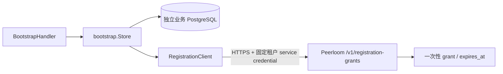

# 安装注册模块

## 当前边界

`internal/peerloom.RegistrationClient` 是服务端使用的公开 HTTP 适配器，`internal/bootstrap.Store` 保存业务幂等尝试；`internal/httpapi.BootstrapHandler` 提供两个注册路径的 HTTP 边界。`cmd/quick-mirror-service` 提供 TLS-only 最小进程，仅开放安装注册，不代表完整群控业务已可用或已经部署。它不引入原产品账号 token 校验，也不向客户端暴露管理凭证。

- 部署配置固定 HTTPS origin、tenant、两个不同的 PC/mobile application。调用只能选择已定义角色，不能传入任意 application 或 URL。
- Peerloom 管理凭证需要目标租户的 `admin` scope；application 必须启用且允许 `grant` 或 `both` 注册。凭证只在服务端配置；不写日志、响应或仓库。
- TTL 默认 300 秒，可配置为 1–3600 秒；不是安装身份本身的有效期，也不解决业务 access token 期限问题。
- 请求使用 `Idempotency-Key`，8–128 个可见 ASCII 字符；同一次尝试必须保留同 key、角色和 TTL。返回原始公开结构 `id/grant/expires_at`，响应限制 64KiB。HTTPS 重定向不跟随。
- `IDEMPOTENCY_CONFLICT` 和 `REPLAY_EXPIRED` 保留明确语义。网络失败、超时、响应损坏或未知服务器错误返回 `OUTCOME_UNKNOWN`，不能据此换 key 重发。适配器本身不执行重试循环，不透传内部错误或响应正文。

Peerloom 的响应保留期默认是 10 分钟与 grant 有效期的较小值，幂等收据默认保留 24 小时；过期收据返回冲突而非重新签发，收据最终清理后保证终止。业务 Store 已持久化 label/角色/key 的语义绑定、随机上游 key 和 24 小时收据。网络调用前先提交意图，不持有数据库事务跨网络。相同 key/body 在重试、并发和重启后沿用同一上游 key；同 key 不同角色或 label 拒绝。安装尝试 key 为随机 UUID，label 最多 256 字节且无控制字符；它们不是身份凭证。

管理凭证、Peerloom origin 或 application 映射改变会使上游幂等域变化：Store 保存不可逆域摘要并拒绝旧尝试重发，避免服务密钥轮换意外签发第二个 grant。业务库不存 grant、管理凭证或 label 明文。收据过期返回 REPLAY_EXPIRED；显式维护入口清理过期收据后，原 key 的保证结束，客户端必须为明确的新尝试使用新 UUID。

HTTP Handler 已实现 POST `/qm/v1/bootstrap/pc` 和 `/qm/v1/bootstrap/mobile`，响应字段见 [OpenAPI](../api/bootstrap.openapi.json)。角色只来自路径，忽略原产品登录体系；不允许请求自报 application/tenant/role。严格拒绝未知/重复字段、非法 UTF-8、多个 JSON 值和超过 1MiB 的正文。响应 `Cache-Control: no-store`；中英文提示与稳定错误码分离。

Handler 使用可配置全局令牌桶及并发资源闸门，不维护无限增长的来源 IP 表，不信任 X-Forwarded-For；过载返回429和Retry-After。这是匿名注册流量预算，不是设备数量限制。运行时配置TLS、读取/头部超时和固定部署身份，具体见 [部署指南](部署指南.md)；不得把 Handler 直接挂到不安全公网监听。令牌桶为进程级，多实例部署还需统一入口限流。

## 验证

HTTP边界测试覆盖实际TLS、路由与角色绑定、契约字段、未知/重复/超大输入、中文错误、并发与速率预算。Go 原生测试使用真实本地 TLS HTTP 服务器，覆盖两个角色的 application 绑定、默认 TTL、保留请求 key、上游冲突/过期、管理凭证失效、畸形/超大响应、过期 grant、无效输入、重定向和取消。测试中的 grant/管理凭证均为固定无效夹具，不是生产密钥。PostgreSQL 集成测试覆盖迁移重跑、100 个并发同 key、Store 重建、语义冲突、服务域隔离、凭证轮换、收据到期及清理；上游 issuer 在该组测试中是记录型夹具，不能替代实际 Peerloom 全链路注册验收。

`go test -race ./...`、`go vet ./...` 和 `go build ./...` 是当前门禁。TLS 夹具验证适配协议，不代表部署后的 Peerloom 注册链路、Android/PC 安装注册或完整产品已联调。
