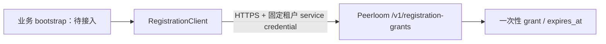

# 安装注册模块

## 当前边界

`internal/peerloom.RegistrationClient` 是服务端使用的公开 HTTP 适配器，不是已经开放的 `/qm/v1/bootstrap/*` 服务。它不引入原产品账号 token 校验，也不向客户端暴露管理凭证。

- 部署配置固定 HTTPS origin、tenant、两个不同的 PC/mobile application。调用只能选择已定义角色，不能传入任意 application 或 URL。
- Peerloom 管理凭证需要目标租户的 `admin` scope；application 必须启用且允许 `grant` 或 `both` 注册。凭证只在服务端配置；不写日志、响应或仓库。
- TTL 默认 300 秒，可配置为 1–3600 秒；不是安装身份本身的有效期，也不解决业务 access token 期限问题。
- 请求使用 `Idempotency-Key`，8–128 个可见 ASCII 字符；同一次尝试必须保留同 key、角色和 TTL。返回原始公开结构 `id/grant/expires_at`，响应限制 64KiB。HTTPS 重定向不跟随。
- `IDEMPOTENCY_CONFLICT` 和 `REPLAY_EXPIRED` 保留明确语义。网络失败、超时、响应损坏或未知服务器错误返回 `OUTCOME_UNKNOWN`，不能据此换 key 重发。适配器本身不执行重试循环，不透传内部错误或响应正文。

Peerloom 的响应保留期默认是 10 分钟与 grant 有效期的较小值，幂等收据默认保留 24 小时；过期收据返回冲突而非重新签发，收据最终清理后保证终止。业务 bootstrap 仍需持久化 label/角色/key 的语义绑定、有效期限和冲突结果，处理返回丢失，并增加有界并发/限流，才能对公网开放。不能只透传 key 就声称完整 bootstrap 幂等已实现。

## 验证

Go 原生测试使用真实本地 TLS HTTP 服务器，覆盖两个角色的 application 绑定、默认 TTL、保留请求 key、上游冲突/过期、管理凭证失效、畸形/超大响应、过期 grant、无效输入、重定向和取消。测试中的 grant/管理凭证均为固定无效夹具，不是生产密钥。

`go test -race ./...`、`go vet ./...` 和 `go build ./...` 是当前门禁。TLS 夹具验证适配协议，不代表部署后的 Peerloom 注册链路、Android/PC 安装注册或完整产品已联调。
