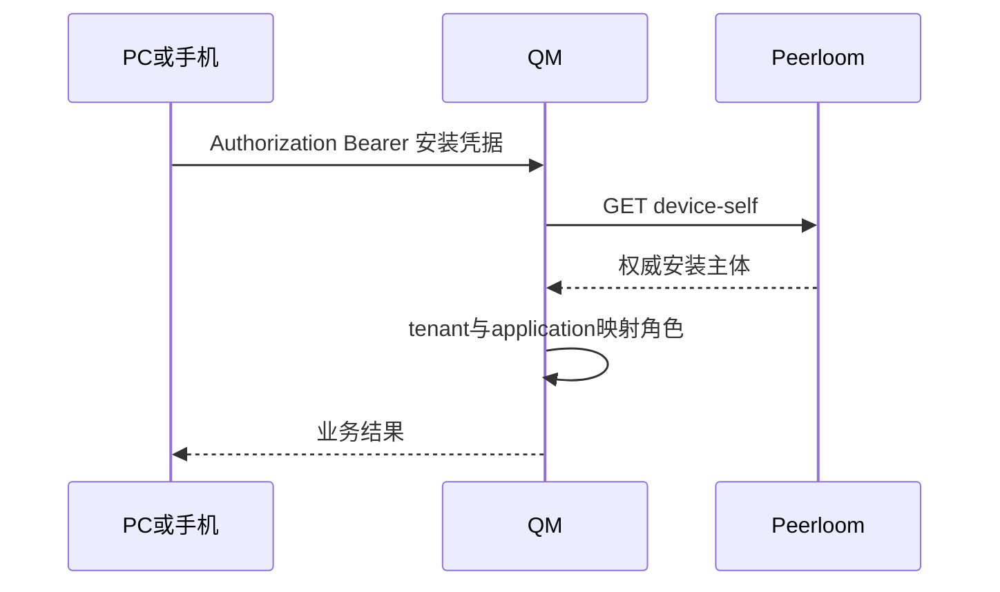

# 安装身份模块

QM 直接验证 Peerloom 安装凭据，不再签发业务 access token，不保存来源凭据密文或专用业务加密密钥。`internal/identity` 定义可信主体，`internal/peerloom` 通过公开 `GET /v1/device-self` 返回权威 device/tenant/application。

安装凭据采用 `until_revoked`，无 expiry 或日常刷新；显式撤销、设备/应用/租户停用仍拒绝。SDK 在系统安全存储持有秘密，QM 普通请求每次重验，不缓存放行。上游故障是 `UPSTREAM_UNAVAILABLE`，不是未绑定或离线。响应 platform/metadata、客户端 role/UUID、原产品账号 token 都不能证明主体身份；service key 不能替代安装凭据。

部署固定一个租户及两个不同 PC/mobile application。适配器强制 HTTPS 根 origin、超时、响应大小与字段约束，禁止重定向；管理凭证只留后端。秘密不进入日志、数据库或响应错误。

初始化使用 `POST /qm/v1/installations/self/ensure`：幂等创建角色对应安装和绑定码，手机同时幂等确保 catalog。重复调用不覆盖绑定/码/boot/seq/权限快照，不制造在线证据。两模块初始化并非跨模块单事务，失败按同一安装重试，不重复注册 Peerloom。bootstrap 仅处理首次安装注册授权。

旧 exchange API、业务 token 和客户端刷新协调已退出本契约；没有双轨兼容或自动身份迁移。正式配套 SDK、安全存储及两端真实链路须单独验收，不能由 Go mock 或旧 v0.1.3 测试推定。
