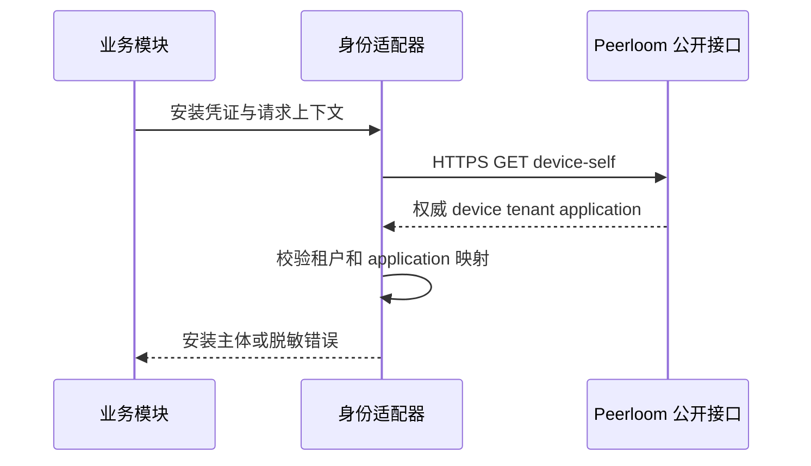

# 安装身份模块

本模块通过 Peerloom 已有公开 `GET /v1/device-self` 验证安装凭证，不查询 Peerloom 私有数据库，不导入其源码，不验证原产品付费账号。

## 信任边界

部署配置指定同一产品租户和两个不同 application UUID，分别对应 PC、手机。请求方不能选择角色，响应中的 platform 和 metadata 也不能升级角色。每次调用重新请求权威服务，无缓存放行、无本地解码 opaque token、无信任 isLoggedIn 的分支。

HTTP client 强制 HTTPS origin、拒绝重定向，超时不超过五秒，响应最多 64 KiB。请求上下文取消会终止请求；异常只返回稳定错误码，不传递内部响应、网络细节或凭证。私有 CA 可通过部署侧 Transport 信任配置接入，不提供跳过 TLS 验证的产品开关。

## 已验证及未实现边界

单元测试覆盖真实本地 TLS 请求、角色混淆、跨租户、撤销凭证、限流、上游错误、截断/超大 JSON、重定向、非法凭证和取消，并使用 race detector。这里不把 HTTP 测试服务器称为真实 Peerloom 联调。

当前公开 device-self 响应未包含本次凭证到期时间；业务 token 要满足契约的 `min(15min, credential remaining)`，必须获得可信的到期信息或另行确定持续在线校验契约，不能相信客户端自报期限。故本阶段没有实现一个会错误延长凭证生命周期的 exchange 接口。目标独占与会话级自定义 TURN 同样等待公开能力落地，不以多个 grant 的单会话配额冒充目标独占。
