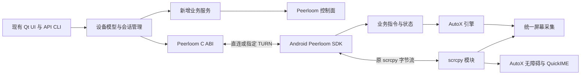
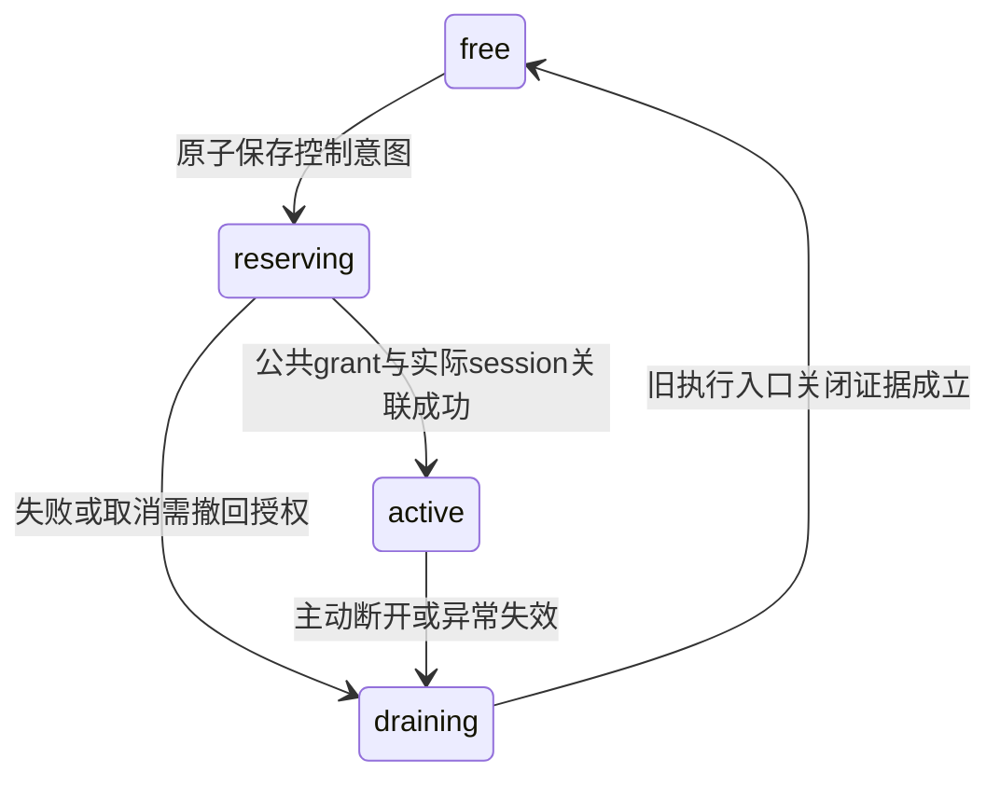

# 无 ADB 群控技术开发文档

架构收敛版本，2026-10-30。依据已确认 PRD 1.2（设备台数不设上限）。本文为开发设计，不代表实现已完成。接口细节见《接口与状态契约》，执行顺序见《Agent开发任务与验收》。已有代码事实以《现状核对与需求追踪》中的提交为基线。

## 1 总体决策

采用“保留现有 PC UI、解码和控制序列化，替换设备发现及连接；在 QuickMirror 集成匹配 PC 协议的 scrcpy 模块；Peerloom 承载业务消息和原始可靠字节流；新增轻量业务服务”的方案。

一台 PC 一个 Peerloom SDK 实例，不按数量限制手机会话数；手机一个 SDK 实例，最多一个 PC 会话。设备列表查询不建立数据会话。停止投屏不关闭设备会话，断开设备才释放占用。原有用户登录和收费系统保持原样；新服务只校验 Peerloom 安装实例身份，一期不校验现有产品账号 token，不在客户端加入管理密钥。

不引入 WebRTC 视频轨道、不替换 PC 视频解码栈、不重写 AutoX、不建设新的账号系统、不引入云端任务调度。必要的新业务消息独立承载，不塞入旧 scrcpy 编号空间。

## 2 仓库和模块边界

| 仓库 | 修改范围 | 不做的工作 |
|---|---|---|
| quick-desktop | 新设备目录来源、Peerloom 封装、会话管理、回环字节流桥、APK 模式启动、UI/API 裁剪、TURN 设置、导入导出 | 重做窗口/群控/收费授权系统 |
| AutoX | quickmirror 宿主、scrcpy 库模块、采集共享、输入适配、JS 接收执行、状态上报 | 改造所有 AutoX 应用变体或新建脚本语言 |
| scrcpy-jar | 作为当前 PC 二进制协议和自定义控制消息的来源；必要适配进入 AutoX 内库模块 | 要求用户安装 jar、shell 进程启动 |
| scrcpy-apk | 参考 APK Context、MediaProjection、无障碍及连接实现，挑选迁移 | 整仓盲目覆盖 scrcpy-jar |
| peerloom | 通用安装身份、授权 grant、会话/租约、消息/流、连接恢复；仅在公开能力缺口经验证后独立扩展并正式发布 | 感知 QuickMirror 的占用策略、投屏、脚本、权限或租赁业务；为产品取消租户隔离或 TLS |
| quick-mirror-service（新目录/新仓库建议名） | Go 模块化单体，业务接口、设备目录、安装实例身份校验、会话请求和状态推送 | 替代 Peerloom 信令/数据传输、复制计费后台 |

新分支名称由实施者按仓库约定创建，使用原项目的独立发行配置；不把旧版用户数据库自动作为新产品数据库。复用原账号授权逻辑和配置项语义，设备/会话/脚本缓存使用新产品独立数据目录，避免旧 ADB serial 被当 UUID。

推荐新增 PC 模块名称为设计名称：DeviceDirectoryClient、PeerloomClient、DeviceSessionManager、LocalStreamBridge、ApkDeviceBackend、CapabilityRegistry。原 DeviceListMonitorEx 接收新来源，继续向现有模型发送增删改事件；一期不启动 AdbDeviceListMonitor 和 QuickForward 分享流程。

## 3 协议来源必须统一

源码来源已重新核对：服务端使用 `barry-ran/scrcpy` 的 `quickmirror_server_3.3`（2d46be297f04e0313f32a33f1e789886f6648742），不使用 `quickassistant_server_3.3`。APK demo 为 `quickassistant_server_3.3_app`（a9a035a164fc9fe9fa1eaa7bf7189dbc6379cc03）。PC qm 的协议和 Server 实现在嵌套仓库 `QtScrcpyCoreQuickMirror`，锁定 30112835775b1fa4ce4a3f80a0c4daec21df178d；必要修改在独立开发分支完成，再更新 PC 子模块指针。

已逐项对照 PC `controlmsg.cpp` 与正确 jar `ControlMessageReader.java`：线上的类型字节为逻辑编号加 0x20；应用请求 ID 为大端32位，图标请求额外包含16位最大尺寸，包名用16位 UTF-8 字节长度；剪贴板有额外 adbPaste 字节，方向采用8位字符串长度。这是静态字段核对，不替代两端真实序列化/解析回归与媒体握手测试。

当前 PC `controlmsg.h` 与 scrcpy-jar 的 58/59/60/61 分别为应用列表、图标、启动、停止；scrcpy-apk 同编号为动态码率、光标显示、无 App 光标显示、光标位置。这是实际冲突，不是理论风险。

Android 集成库以 scrcpy-jar 的 ControlMessage/Reader、DeviceMessage/Writer 及 PC 消息布局为准，迁移 scrcpy-apk 的平台适配。保留 51–57 的现有参数控制语义；61 停止应用本期拒绝执行，但正确解析整条消息，不能错位解码后续输入。不引入 APK 分支的 50、58–61 新语义。

定义兼容标识 `quick-scrcpy-control-v1`，在新业务 hello 中协商。现有 scrcpy 字节流不插入 hello、JSON 或新包头。双方标识不匹配则在启动媒体前返回 PROTOCOL_UNSUPPORTED。不要使用 `ServerParams.serverVersion` 字符串单独判断兼容性。

交付协议字节样本：PC 编码生成与 Android 解析逐条对照；包括文字 UTF-8、多指 ID、坐标、动态设置、应用消息、服务端回包。视频握手也用样本锁定 dummy 字节、设备名、codec 元数据和帧元数据顺序、大小端。格式从现有序列化器提取，不从 upstream scrcpy 版本号猜测。

原 qm 的 ADB 路径保持不变。NoADB 开发分支采用显式 direct transport 入口，跳过 push/forward/reverse/execute/ADB cleanup，dummy/metadata 按增量状态机读取，不依赖固定 70ms 延时。Core 保留原控制字节、解码和渲染主链；Peerloom 身份、信令、独占、TURN 与 JS 业务通道放在 PC 上层，不借传输接入重构 Core。现有原字节流接缝验证不代表正式 Peerloom 流 pump 已完成端到端接线。

## 4 数据通道及桥接

一个会话的默认 reliable_message 通道承载 RPC/事件；显式打开 video/control 两个 reliable_stream；JS 上传时最多再打开一个 upload reliable_stream。配置每会话最多 8 个活动通道，预留关闭中的资源，不使用低可靠通道传输旧协议。

PC 最小改动方案：LocalStreamBridge 在 127.0.0.1 动态端口提供独立 video/control 接入口；Server 新增 direct transport 参数，保留 VideoSocket 和 QTcpSocket 接口。两端口角色固定，不通过 TCP 到达先后猜测。原输入控制器、demuxer/decoder 不直接依赖 Peerloom。

Device 的每次 connectDevice 调用必须且只能产生一个可观测成功或失败终态，disconnect 同样如此。重复/忙碌拒绝、取消、超时、连接中断开、远端断线和销毁不能静默吞调用或重复通知。按调用与 operation generation 关联终态，迟到回调不能结算新调用；不能仅凭总事件数相等证明正确。保留原 API 事件兼容性，listener 生命周期和析构通知必须避免 UAF，并验证有限期限内收敛。

每个本地连接先写 32 字节随机 attach token，桥接器消费后才转发原字节；token 从进程内传给 Server，不写入媒体、不写日志。桥接器只接受指定会话、媒体代次、角色的一次接入，不监听 0.0.0.0。本地 token 属于内部接入口隔离，不是用户配对验证。

Android 保留 Streamer 的 FileDescriptor 形态：使用 `ParcelFileDescriptor.createSocketPair()` 为 video 和 control 创建进程内双向端点；一侧交给 scrcpy，另一侧由 Peerloom pump 收发。为 DesktopConnection 增加明确的 APK factory，控制消息复用 InputStream/OutputStream 解析；关闭归属由连接对象统一管理。不使用概念验证中对外监听 0.0.0.0 的 TCP server。

媒体建立顺序：RPC mirror.start 校验权限和配置 → Android 建立本地端点并准备管线但不等待 PC TCP → 回答 media_generation 和两通道 label → PC 打开两条流 → Android 以 label 关联两个端点 → 两通道 ready 后开始字节转发及编码 → PC 读完旧握手才报告 mirror ready。任何步骤失败清理本代所有媒体资源，设备业务会话仍可保留。

停止/重启投屏创建新的 media_generation，旧流关闭；业务连接不变。每次重建重发原协议初始化字节和首个可解码关键帧，不能将新编码器数据拼接到旧 parser。参数变化优先沿用既有控制消息；必须重建编码器时遵循相同代次规则。活动与退役通道应及时释放，遵守已发布 SDK 的资源与生命周期契约；不得把累计创建次数当作产品设备数上限。若已发布版本要求回收/重建，使用有界且可验证的恢复流程，脚本不因重建被重新执行。

### 4.1 背压与线程

- 任何 SDK 回调先复制必要内容、投递工作队列并立即返回；不得等待 Qt UI、JNI UI、流读取或自身 completion。
- 每个 stream 最多一个 pending READ；WRITE 按实际 written 字节推进，最多 64KiB/次；OUTCOME_UNKNOWN 不重发字节，关闭该媒体代重建。
- PC 每设备 video 应用缓冲上限 2MiB、control 每方向 128KiB、upload 256KiB；Android 同等上限。计入 SDK/内核缓冲另行测量，不能把这些数字当总内存。
- 满时停止向上游读取形成背压。原视频流不能任意丢字节；持续超时按 Peerloom 流失败关闭并恢复。不增加自动降码率。
- 按设备轮询公平调度，业务消息和 control 不被某路视频/上传堵死；SDK 共享关联的队头阻塞仍需弱网测量，不承诺低延迟消息独立于 WebRTC 拥塞控制。
- 单路媒体失败不关闭其他设备；UI 更新节流合并，不按每个帧回调刷新整个 设备列表。

## 5 正式 Peerloom 能力与业务边界

公开能力证据锁定于 v0.1.3：[`management/http_resources.go`](https://github.com/barry-ran/peerloom/blob/0b0d2962cd36338e1a92f3321c60d26ede1fdb51/src/device-server/internal/management/http_resources.go#L58-L145)（grant/session/device路由）、[`authorization/transactions.go`](https://github.com/barry-ran/peerloom/blob/0b0d2962cd36338e1a92f3321c60d26ede1fdb51/src/device-server/internal/authorization/transactions.go#L52-L68)（撤销/终止）、[`authorization/model.go`](https://github.com/barry-ran/peerloom/blob/0b0d2962cd36338e1a92f3321c60d26ede1fdb51/src/device-server/internal/authorization/model.go#L21-L47)（租约默认值与状态字段）。源码核对不是产品运行验收。

### 5.1 不设固定设备台数上限

服务端/API基线为正式 Peerloom v0.1.3（`0b0d2962cd36338e1a92f3321c60d26ede1fdb51`）；PC与AutoX当前SDK锁定v0.1.2，不能把服务端升级写成客户端已升级。各客户端保留自己的正式发行锁文件、平台产物及校验和，验证v0.1.2 SDK与v0.1.3服务端兼容；不因本文统一升级，不编入候选分支源码。旧源码的32连接/32操作额度是历史问题，不能继续当作该版本未实现的改造任务。先核对正式包的容量、操作回收与管理通路，再以真实负载验证，而不是重复扩建。

当前客户端锁证据：[PC deps/peerloom-release.lock.json](https://github.com/barry-ran/quick-desktop/blob/f56eb8ba300b6d4917e026f3017d46e04887f815/deps/peerloom-release.lock.json#L3-L8)（v0.1.2、tag提交1ab0dd73e4222f8eb3c17aa44ffc1ab304496678、仅公开发行二进制），[AutoX quickmirror/peerloom-sdk.lock.json](https://github.com/barry-ran/AutoX/blob/36febcaf47f427ef2f87fd95fd567817543774ec/quickmirror/peerloom-sdk.lock.json#L2-L6)（v0.1.2、AAR校验和）。身份联调后端v0.1.3不等于这两个锁文件已经升级。

产品仍不设置固定设备台数上限，不以每手机一个 SDK 实例绕过容量问题。资源预算、背压、输入长度与恶意流量保护保留；分页/分批处理全部设备，遇限流按 retry_after 调度，不能截断队列。每条流保持一个 pending read；关闭/取消必须在读写负载下收敛。

Android armeabi-v7a 仍是交付要求，但当前v0.1.2正式AAR缺少ARM32，v0.1.3 Android构建配置也只列arm64-v8a/x86_64；ARM32 正式包及运行证据未闭环。若需改库，作为通用 ABI 支持独立验证、发布后再消费，不用候选源码冒充正式依赖。

验收覆盖跨越旧 32/100 阈值、100 和 500 会话档位，以及资源允许的更高档位；记录系统 FD、线程、CPU、内存、编码和带宽消耗。资源不足明确反馈具体失败，不显示虚构的“产品最多支持 N 台”。不能声称有限硬件上的无限并发。

### 5.2 业务控制占用与通用连接授权

QuickMirror service 决定哪台 PC 获准控制手机；Peerloom 决定网络连接是否拥有有效授权。业务 PostgreSQL 以 service_scope+target_uuid 串行化唯一活跃控制意图，保存 owner、command_id、业务代次、grant/session 关联及恢复状态；不读 Peerloom 私表，不复制其传输状态机，不增加第二个 Redis 独占锁。

先持久化意图，再以固定幂等 key 调用公开 connection-grants；不持事务跨网络。超时/响应丢失保留原意图，同 key 查询/重试，不换 key 创建第二份授权。PC 使用普通 SDK connect；手机利用已有 accept/reject，验证认证对端与业务意图匹配，不显示新增配对审批。实际 session 建立后再关联意图，不预先伪造 session_id。不依赖 prepare-exclusive-session、connectPrepared 或候选 exclusive_target 协议。

手机是最终执行门禁：所有远程输入、RPC、上传提交及媒体接入口在执行前检查当前 owner、意图/业务代次及实际有效 session；撤销与最终执行接纳在同一个受控执行边界线性化，不能仅做isCurrent检查后异步执行而留下竞态；迟到回调、旧流和恢复句柄不得重新打开旧授权。业务代次不是 Peerloom transport generation，原 scrcpy 字节不增加包头。新会话开放前先停用旧执行入口并处理旧输入队列/手势。

断开先禁止本地新输入和调用，关闭流；服务进入 draining，显式撤销旧 grant，必要时终止已知 session。grant 的 no_new_connections 到期语义不保证已有连接终止，不能把 grant 到期时间直接当旧数据会话截止时间；期限与续租策略须按正式库契约确定。不能把服务端 closed、PC 单方 close 回执、在线状态或 max_connections=1 当作旧分区数据通道已停止的证明。只有手机已认证确认旧入口关闭，或旧授权的可靠最大有效期限已被证明经过，才允许新 owner。撤销结果未知保持 draining 并幂等恢复；业务服务重启从持久记录继续，不能清空锁后重新授权。

正常在线续期与释放是两条路径：SDK按公开契约维持传输租约，业务服务的活跃意图只能在当前owner、有效会话及身份仍匹配时维持；不自行延长SDK期限。安装credential刷新、业务token重新exchange、传输租约续期及grant到期各有独立期限，不能相互代替。grant策略需明确已有连接的续租和未来重连行为；没有公开原位续期能力时，不假定存在更新接口，也不因定时器到期换grant并重放业务。续期结果未知以实际有效期为边界，失败进入恢复/释放流程；关闭开始后停止续期，不与draining竞争复活授权。

两端停止采用异步生命周期：停止接收新请求、关闭执行入口、取消/关闭通道和挂起操作，等待既有回调结算与工作对象drained后再销毁。PC不得用QEventLoop或阻塞UI等待；手机清理ACK只能在旧输入队列/手势及资源不再能执行旧命令后发送。drained是资源生命周期事实，不等于服务已free；每个connect/disconnect仍需一次终态；disconnect成功必须以资源drained为条件，超时只报告一次失败，保留Closing owner，不再补发成功、不复用旧媒体对象。尚未安全释放的资源保持受控且不得UAF；QObject清理留在既有归属线程，不能把delete随意扔到worker。

租约默认60s、确认窗口30s是正式库默认配置，不是无条件安全切换承诺。休眠/恢复、单调时钟、迟到交付与最大有效截止时间仍需验证；可靠期限未证明且没有手机清理 ACK 时保持 fail-closed，允许慢接管，不以固定等待60s或额外2s猜测安全。通用租约时钟缺陷应单独修复并发布，不以产品专用 epoch 协议代替。

主动断开携带 user_pc/user_phone，PC 清除自动连接意图；异常断线不清除意图，沿用1/2/4/8/15s抖动退避，遇占用停止抢连。已启动 AutoX 脚本继续运行不代表旧 PC 仍可发新命令；重连只查询，不重放 script.start，不新增脚本暂停/互斥政策。

### 5.3 自定义 TURN

现有 Peerloom 只向双方提供服务端批准节点的短期 TURN REST 凭证，不等于支持 PC 填任意 TURN。自建 TURN 仍是产品要求；正式 v0.1.3 的任意静态 TURN 会话配置能力尚未闭环，不能只把设置框做出来，也不能假定候选接口已发布。先证明公开接口缺口，再独立设计通用 ICE/relay 配置扩展并正式发布；默认 TURN 链路开发不依赖该候选扩展。

一期自建 TURN 支持标准静态 username/password 与最多 4 个 turn/turns URL；不要求用户把 TURN 管理共享密钥放入 PC。默认模式仍由现有 Peerloom 签发短期凭证。自定义配置经 HTTPS 提交给业务服务加密保存，限定 owner PC identity，创建会话时冻结 revision；最终接入必须保证双方该会话使用一致的 ICE 配置；具体公开接口以验证并正式发布的契约为准，不在本文假定已有 relay-profile API。只有本会话参与端可获取。密码不进入数据库明文字段、URL 日志或导出文件。

custom 模式的 ICE 列表不得混入默认 TURN；auto 仍可尝试直连，直连成功不代表验证了自建 TURN。失败时无默认中继回退。工程测试支持 relay_only，但不新增用户画质策略。服务端不对用户填写的地址进行 HTTP 抓取；客户端按标准 TURN URL 使用。会话恢复沿用 profile revision；修改配置只影响后续新会话。

## 6 Android 集成

### 6.1 生命周期与身份

QuickMirror 宿主 minSdk26；保持 arm64-v8a、armeabi-v7a 目标。scrcpy 作为 Android library，不独立安装第二个 APK。禁用 shell cleanup、app_process、反射 INJECT_EVENTS fallback、QuickAssistant 特权入口和隐式 System.exit。所有必要操作走普通 APK 能力。

首次启动 UI 立即进入权限引导，同时异步启动注册及在线上报。安装实例身份保存在 noBackupFilesDir，凭证使用 Keystore；正常升级不重置。清除数据/卸载重装创建新 UUID，不能根据 ANDROID_ID 硬件号恢复旧设备身份。身份损坏明确报错，不静默创建同物理设备的多个身份。

前台服务按实际用途声明类型，录屏先用户授权后启动对应服务并创建 projection；不通过 BOOT_COMPLETED 自动新建录屏授权。联网但未授权状态可由前台可见应用/合法服务上报，后台被系统杀死应如实离线。不能承诺永不被系统杀死。新产品单 JS 内部存储不依赖 MANAGE_EXTERNAL_STORAGE；脚本读取外部资源仍按原权限模型处理。

### 6.2 统一屏幕采集是必做项

不能把 scrcpy 的 MediaProjection 和 AutoX ScreenCapturer 各自独立启动：新系统对 token 重用和多次 createVirtualDisplay 有限制，两个录屏会话也可能互相终止。

实现 ProjectionCoordinator 唯一拥有 MediaProjection、回调和一个 VirtualDisplay。以屏幕实际像素尺寸采集到 SurfaceTexture/OpenGL；复用 scrcpy OpenGL 管线，输出到编码器 Surface；AutoX 截图从相同源按请求渲染到离屏 framebuffer 后读取完整屏幕像素。保持 AutoX 原截图坐标系，不能返回 PC 720 缩略帧替代手机原分辨率。

提供 ScreenshotProvider 给 QuickMirror 使用的 AutoX capture facade；AutoX 主 app/inrt 默认路径不变。requestScreenCapture 有有效授权时复用，没有授权时立即返回失败；APK UI 单独负责授权，不让脚本启动另一个弹框流程。capture 获取最新有效帧，沿用引擎已有首帧读取等待，不新增“等权限”计时器；授权失效立即抛出权限错误并清除旧图缓存。

投屏停止只停止编码器/传输消费者，不释放 ProjectionCoordinator；脚本截图仍可用。无消费者时保留有效授权和采集资源的生命周期，可暂停不必要的帧处理但不能销毁后重复使用 token 新建 display。手机主动停止系统录屏、进程退出或 onStop 时统一释放并等待用户重新授权。

屏幕旋转使用已有 VirtualDisplay.resize/setSurface 更新和对应变换；不重复 createVirtualDisplay。视频缩放/旋转与触摸反变换使用同一 CaptureGeometry（屏幕尺寸、视频尺寸、旋转、裁剪、generation）。旧几何的 touch 不能投递到新旋转状态；状态更新时结束旧手势。

Android14+ 优先申请整个默认显示屏；若系统最终只允许/选择单应用捕获，明确提示需全屏授权并禁用坐标控制，不按全屏坐标误操作。安全窗口/DRM 的系统遮挡不绕过，不宣称黑色内容是连接故障。

### 6.3 无障碍和输入法

复用 AutoX 现有无障碍服务，增加远程输入入口，不要求用户同时开启两套无障碍服务。按 pointerId 聚合多指动作，API26 continueStroke 保留按下连续性；处理 ACTION_CANCEL、权限撤销、旋转及断开时的手势结束。不得复制概念验证中每次新建笔画却声称连续拖动的逻辑。

同步控制沿用 PC 的坐标换算和群控节奏；远程输入与 AutoX 手势共享服务但不增加产品层优先级或脚本暂停。Android dispatchGesture 的互相取消可能发生，按系统结果处理。

文本 54/56 等原消息由应用内部调用 QuickIME 的 InputConnection，不能继续 adb broadcast。仅在 QuickIME 已选择且有可编辑连接时发送；否则返回 IME_REQUIRED/INPUT_TARGET_UNAVAILABLE。返回/主页/最近任务/通知栏用无障碍 global action；普通文本键用 IME；任意全局物理键注入不支持。

### 6.4 能力表

| capability | 一期实现和限制 |
|---|---|
| video、screenshot、touch | Android8+ 核心必交付，需录屏/无障碍对应权限；受保护内容遵守系统 |
| text、editor_action | 内置 QuickIME；首次手动启用，目标字段必须可编辑 |
| back/home/recents/notifications | 无障碍可用时提供；失败如实返回 |
| clipboard | QuickIME 为默认输入法或应用具备系统允许的访问条件时可用；权限不足禁用相应同步，不无限读空值覆盖 PC 剪贴板 |
| volume | 使用公开 AudioManager 可用范围；勿把任意键注入当作实现 |
| app_list/icon | 返回系统允许看到的可启动应用；使用 manifest queries 和 PackageManager，不承诺所有隐藏/工作资料应用 |
| app_launch | 通过公开 Intent，在系统允许后台启动条件下执行；受限时返回 APP_LAUNCH_RESTRICTED，不使用 shell fallback |
| wallpaper_number | 复用 QuickMirror SET_WALLPAPER 路径 |
| audio | 当前 PC 明确 audio=false；一期沿用，不新增音频流/播放栈 |
| display_power/system_resolution/reboot/force_stop/clear_data/install/uninstall/files/ADB/Shell/share | 一期不支持，UI 隐藏、外部接口拒绝 |

能力分为 supported（版本实现是否支持）与 available（当前权限/状态是否满足），禁止仅用一个布尔隐藏“待授权”。平台差异通过能力描述隔离，后续 iOS 不假装支持 Android 无障碍或 AutoX。

## 7 业务服务器与现有授权

采用 Go + PostgreSQL 模块化单体，业务模块单独发布，仅通过 Peerloom 公开接口通信。PostgreSQL 保存业务目录、控制意图与待接入的 relay profile；业务服务不新增必需 Redis。网络在线状态通过 Peerloom 公开设备查询取得，权限/能力是手机业务快照；查询失败显示 unknown。推送仅提示变化，重连重取快照，不作为授权事实。Peerloom 自身部署依赖与业务数据库隔离。

一期暂不接入现有账号 token 的服务端校验，不实现 LicenseVerifier，不把现有账号服务验证接口作为开工或发布前置条件。PC 仍按原逻辑登录、收费及授权；新业务服务不接收原登录 token，不判断账号付费权益，也不声称已经完成服务端账号授权校验。

PC 和手机都通过各自专用 application 的 bootstrap 注册为 Peerloom 安装实例，获得各自凭证；随后凭 Peerloom 安装凭证交换短期业务 token。服务端验证的是安装实例及其应用角色，不是付费账号。所有 relay profile、会话发起者和设备状态仍按真实实例身份关联。后期若需要服务端账号校验，可在独立边界补充，不预置 mock 通过或强制开关占位。

手机首次注册无需用户账号：为专用 mobile application 开放受限的 bootstrap 注册入口，经 Peerloom 一次性 grant 创建安装身份，注册回执按幂等 key 持久恢复。手机后续业务身份必须验证 Peerloom 设备凭证，不能只凭 UUID。PC 和手机部署在同一专用产品租户，不把现有付费账户一一映射成互相隔离的 Peerloom 租户，否则会违反知道 UUID 可添加的产品要求。现有账户权限由 PC 原有产品逻辑处理，新业务服务一期不验证账号权益，不额外增加手机所有者权限。

身份适配已使用 Peerloom 公开 GET /v1/device-self，以安装凭证校验权威 device/tenant/application；不轮换设备 token、不读取私表、不暴露凭证哈希。正式 v0.1.3 已返回同次认证的 credential_expires_at，当前 exchange 已按 min(15min,remaining) 签发并逐请求重验；缺字段/上游不可达失败关闭。服务管理密钥仅保留后端，PC/APK 不携带管理 token。

## 8 数据、部署与交付

已有业务表以当前 migrations 为准：qm_device_catalog/qm_device_boots、qm_bootstrap_intents、qm_access_tokens/qm_access_key_usage。后续新增控制意图（target、owner、command_id、业务代次、state、grant/session关联、释放证据）与 relay_profiles（owner、revision、加密凭证）。不在 Peerloom 建产品独占资源表；迁移独立版本，不改已部署 migration。

PC 本地表按 service_scope+UUID 唯一，名称/编号/分组是本 PC 元数据；`serial` 若旧 API 必须保留则在新产品中映射 UUID 字符串，不重新生成伪 adb serial。离线已注册设备可保存，导入按 UUID 去重，已有本地元数据不覆盖。导出 JSON 的精确定义见接口契约。

部署提供 Linux amd64 Compose：业务服务、Peerloom 既有服务、PostgreSQL、Redis，以及可选默认 coturn；默认 TURN 的 UDP/TCP/TLS 和 relay 端口范围由部署文件显式配置，业务 HTTPS/WSS 域名与中继域名分开。保留 Peerloom 的 TLS 验证，不把测试 CA/开发例外带入发行包。

发行锁定 PC、APK、Peerloom、业务服务、协议标识的版本清单；APK 使用正式签名，不能沿用概念验证 debug signing。Android 测 API26、29、34、35/36，覆盖 arm64 和 armeabi-v7a 真机/可运行环境及 16KiB 页设备；桌面使用现有 Qt/CMake 工具链和 SDK 对应架构，Windows 为运行交付，macOS/Linux 构建验证。

升级先兼容服务端，再客户端。协议/能力不兼容明确提示，旧客户端不进入有冲突编号的媒体流。数据库升级前备份；回滚只在兼容 schema 范围内，不自动降级删除用户记录。设备身份数据不得因清缓存/升级清理。

## 9 官方约束和事实依据

- [MediaProjection](https://developer.android.com/media/grow/media-projection)：单会话授权、token/display 生命周期、前台服务和捕获尺寸处理。
- [无障碍手势](https://developer.android.com/reference/android/accessibilityservice/AccessibilityService#dispatchGesture(android.accessibilityservice.GestureDescription,%20android.accessibilityservice.AccessibilityService.GestureResultCallback,%20android.os.Handler))、[连续笔画](https://developer.android.com/reference/android/accessibilityservice/GestureDescription.StrokeDescription)。
- [Android10 剪贴板约束](https://source.android.google.cn/docs/whatsnew/android-10-release?hl=en)。
- Peerloom 现有 C ABI、Android 源码及中继契约以现状核对中固定提交为基线；本文 max_connections/操作配额、exclusive_target、custom relay profile 均为待开发扩展，不能当作现有 API 已支持。
