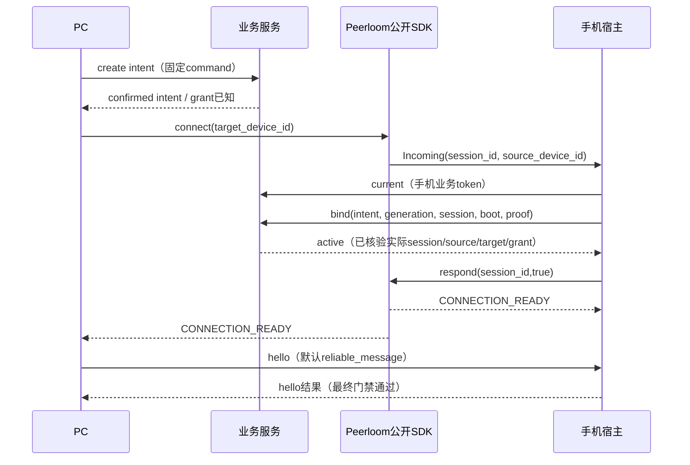

# 无 ADB 群控接口与状态契约

架构收敛版本，2026-10-30，对应 PRD1.2。bootstrap/exchange/catalog 的已实现字段以 api 下 OpenAPI 为准；状态推送、会话编排和 RPC 为待实现设计，不是假定已提供。实现阶段先生成 OpenAPI、JSON Schema 和测试样本，再由双方按同一契约开发。旧 scrcpy 二进制协议保持当前 PC 布局。

## 1 标识与版本

- device_uuid：Peerloom 安装实例 UUID，跨重启/普通升级稳定；仅设备注册生成，输入大小写规范化为小写。
- pc_uuid：PC 安装实例身份，与现有账户 subject 不同；重新登录不生成新身份。
- service_scope：服务端部署的固定 UUID，防止不同服务域设备混用；客户端不可自报租户。
- session_id：权威 Peerloom 会话 UUID；owner_pc_uuid 与 target_device_uuid 不可更换。
- intent_id：QuickMirror 业务控制意图 UUID；business_generation：同一 target 的业务授权代次，JSON 用十进制字符串；二者不要求 Peerloom 理解或保存。
- transport_generation：Peerloom 的传输重建代次；media_generation：应用媒体重建计数；二者不可混用。
- request_id/command_id：随机 UUID；前者关联请求，后者是业务幂等键，不是认证凭证。
- 所有时间戳为 UTC RFC3339；UI 按本地时区显示。租约失效不能仅依赖客户端墙上时钟。
- rpc_major=1；scrcpy_profile=`quick-scrcpy-control-v1`。不匹配时明确拒绝，不按未知编号尝试解码。

## 2 认证边界与业务 HTTP

PC 和手机均使用经可信服务验证的 Peerloom 安装实例凭证交换业务 access token。token 绑定主体类型、安装 UUID、service_scope、期限。PC 与手机角色来自注册所属 application，不能信任请求体自报角色。所有 HTTP/WSS 使用 HTTPS/WSS。UUID 添加不增加配对密码或手机审批。

甲方已确认一期不校验现有账号登录 token：不实现 LicenseVerifier，不依赖现有授权服务验证接口，不向新业务服务转发原产品登录 token。PC 原有登录、收费和授权逻辑保持不变。业务 token 有效期为 15min 与 Peerloom 安装凭证剩余有效期的较小值，到期前续签；这证明安装身份，不代表付费权益。

通用响应：成功 `{request_id,data}`；错误 `{request_id,error:{code,message,retryable,retry_after_ms?}}`。业务 UUID 不存在 404、已占用/状态冲突 409、参数错误 400、认证错误 401、安装角色/会话操作无权访问 403、负载暂满 429/503。正文 UTF-8；禁止凭证、JS 正文进入日志。批量接口返回每项结果，不以一个总成功掩盖失败。

| 方法与路径 | 输入/输出 | 语义 |
|---|---|---|
| POST /qm/v1/auth/pc/exchange | PC Peerloom credential 经 Authorization；输出 access_token、expires_at、scope | 验证 PC application 安装实例，pc_uuid从凭证派生，不验证产品账号 |
| POST /qm/v1/auth/device/exchange | Peerloom device credential；输出短期业务 token | 通过内部 adapter 验证主体 |
| POST /qm/v1/bootstrap/pc | install_public_label、idempotency_key；返回一次性 registration grant、PC application_id、Peerloom origin | PC 安装注册；不需要原账号 token，按幂等规则处理 |
| POST /qm/v1/bootstrap/mobile | install_public_label、idempotency_key；返回一次性 registration grant、application_id、Peerloom origin | 无用户登录；安装身份注册；相同 key/body 返回相同结果，冲突409 |
| POST /qm/v1/devices/resolve | uuids 数组；输出 items[uuid,found,status,capabilities] | 仅校验注册存在性，不建立连接；离线 found=true |
| POST /qm/v1/devices/status | uuids 数组；输出快照及 snapshot_revision | 快照 revision 与增量推送对齐 |
| PUT /qm/v1/device-self/status | boot_id、seq、permissions、capabilities、app_version | 仅手机本人；新 boot_id 清旧 seq，不信任外传 device_uuid |
| POST /qm/v1/relay-profiles | mode=default/custom，custom URL/user/password；输出 id、revision、脱敏摘要 | PC 本人配置；更新创建新 revision，不改现有会话 |
| POST /qm/v1/session-intents | device_uuid、relay_profile_revision、command_id | 原子保存控制意图，返回 intent_id/business_generation/state；session_id 在实际建立并验证后关联，不预留 Peerloom session |
| GET /qm/v1/session-intents/by-command/{id} | command_id | 恢复请求结果；避免响应丢失再申请第二个会话 |
| POST /qm/v1/session-intents/{intent_id}/close | reason=user_pc/user_phone/error；command_id | 仅参与端；返回draining/原终态，不用202假装已经释放 |
| GET /qm/v1/session-intents/{intent_id} | 无 | 业务意图与已关联传输状态、business_generation、close_reason；不可读取其他意图 |
| GET /qm/v1/events（WSS） | access token 用安全握手方式；subscribe UUID 分批 | 状态变动提示；重连后重取快照，不把事件当唯一事实 |

每个 resolve/status 批次最多 200 UUID 是请求体界限，不是设备台数上限。客户端自动分批直到全部完成；分页/订阅可分批累积任意设备数，不截断第 201 项。HTTP body 默认 1MiB；单订阅消息 64KiB。状态推送使用有界队列，过载合并同 UUID 最新状态，必要时发送 resync_required，客户端批量重取。

手机在线由认证心跳/租约判断，status 中的权限是能力快照；离线后的旧 permission=true 不能显示成当前可操作。业务目录、Peerloom 和 PC 状态不一致时以权威会话与在线状态重新同步，不能单凭上一帧存在判定在线。

### 2.1 正式 Peerloom 公开适配与业务占用

服务端/API基线为正式v0.1.3（0b0d2962cd36338e1a92f3321c60d26ede1fdb51）；PC/AutoX客户端SDK当前各自锁定v0.1.2，需验证该组合，不假定已升级或新增升级前置。使用公开 POST /v1/connection-grants、GET/DELETE /v1/connection-grants/{id}、GET /v1/sessions/{id}、POST /v1/sessions/{id}/terminate 和 GET /v1/devices/{id}，以及普通 SDK connect/accept/reject。管理凭证仅在服务端，不读私表，不要求 prepare-exclusive-session/connectPrepared。

业务状态 free→reserving→active→draining→free；target 唯一活跃意图在业务 PostgreSQL 中串行化。先提交意图再调用上游，固定幂等 key；上游结果未知不得换 key、释放占用或新发授权。终态命令收据保留24h，过期查询不到不能自动重发。手机核对认证对端、当前意图与实际 session 后才开放执行入口；最终接纳和撤销在同一受控执行边界线性化，不能检查后无保护地执行；业务代次隔离旧回调与流，不改变 scrcpy 字节格式。

关闭进入 draining，显式 revoke grant（仅 terminate session 不足以阻止仍有效 grant 再连接）。服务端 closed 不等于远端分区通道已停止。只有认证手机清理 ACK 或经过验证的最大旧授权截止时间成立，才能 free；否则继续恢复查询/重试并保持不可转交。不能用 max_connections=1 或固定睡眠替代释放证明。具体状态查询/手机绑定与清理 ACK 已由下节七路由及共享 OpenAPI 定义并在服务实现。

正常续期保持同一控制意图与业务代次，不作为新一次用户连接。安装凭证刷新、业务token交换与SDK传输租约各按其公开契约处理；grant期限/策略须保证合法长连接和重连语义，不能假定不存在的grant更新接口。关闭进入draining后停止该意图的续期；迟到成功回调不能把它恢复为active。认证失效/未知结果按有效截止时间处理，不凭缓存续命。

停止/清理采用异步请求与drained完成通知，禁止UI嵌套QEventLoop。手机关闭入口、处理旧队列/手势并确认无旧命令可执行后才发送认证清理ACK；SDK操作与回调结算后再销毁资源。客户端调用终态、资源drained、服务端free是三个不同事实，不能互相冒充；disconnect成功需资源drained；超时只返回一次失败并保留Closing owner，后续收尾不得再次回报成功或复用旧媒体对象，未确认释放保持draining。

自建 TURN 的通用公开配置接口、租约跨休眠可靠时钟和 ARM32 正式包是独立未闭环项；不得以候选实现代替正式发行依赖。业务服务与 Peerloom 不共享数据库事务。

### 2.2 控制意图共享接口与恢复约束

精确字段以 `api/session-intents.openapi.json` 为准，故障输入/期望见 `api/fixtures/session-intents-faults.json`。这两个文件对应服务 master 2b211b1 已实现的七条控制意图路由；客户端应用接线仍待实现。第一阶段仅接默认TURN；custom明确返回RELAY_CONFIG_UNSUPPORTED，不回退默认配置，也不取消后续自建TURN需求。

| 操作 | 路径 | 权限与主要结果 |
|---|---|---|
| 创建 | POST /qm/v1/session-intents | PC；target+command_id，返回原意图及当前状态 |
| 按创建命令恢复 | GET /qm/v1/session-intents/by-command/{command_id} | 原PC；未知/结果过期返回UNKNOWN，绝不创建 |
| 查询 | GET /qm/v1/session-intents/{intent_id} | owner PC/target手机；不要求session已经存在 |
| 关闭 | POST /qm/v1/session-intents/{intent_id}/close | 两端参与者；command_id+reason，返回draining或原终态 |
| 手机当前意图 | GET /qm/v1/device-self/session-intents/current | 手机本人；无slot返回204，有活跃意图返回200；用于incoming/重启恢复 |
| 手机绑定 | POST /qm/v1/device-self/session-intents/{intent_id}/bind | 仅target手机；command_id+业务代次+实际session_id |
| 手机释放确认 | POST /qm/v1/device-self/session-intents/{intent_id}/drained | 仅target手机；command_id+业务代次+drain_token；已有绑定必须匹配session_id，无绑定必须省略 |

所有ID与command_id为UUID，不是访问凭证。service_scope来自部署，owner/target来自已认证主体；调用不得提交owner、tenant或角色。命令键按service_scope+principal+operation+command_id隔离；参数规范化摘要冲突返回IDEMPOTENCY_CONFLICT。generation/revision为正十进制字符串，数值上限9223372036854775807；generation是授权代次，revision是快照版本，递增溢出失败关闭，不得回绕。retry_after_ms限制0..60000。未授权读取intent按不存在处理，by-command限定本人create命令。drain_token仅返回目标手机，不能由PC替手机提交。

目标占用槽与意图历史分开：slot空闲没有活跃intent；intent状态为reserving/active/draining/released/failed。active只表示已核验业务绑定，不等于SDK已经connected。一个intent最多绑定一个实际session；SDK同session传输恢复不改变业务代次，换session必须先安全终结旧intent，不复用旧绑定。手机incoming事件只有source/session时，先认证查询current获取intent，无占用则reject，不通过尚未建立的业务RPC寻找意图；手机bind时服务从公开Peerloom接口核对session的source/target/grant和授权有效性，手机仍须等SDK就绪才交付业务。bind结果丢失只恢复原绑定，不能覆盖为另一session。

详细终态结果保留24h；活跃/未知意图不按24h删掉。过期后保留紧凑command tombstone（scope、主体、操作/key、参数摘要、意图/终态摘要），返回UNKNOWN且禁止重新执行旧key。它是业务幂等记录，不是第二身份或传输状态机；不保存token、管理凭证、敏感请求正文。空间随操作数增长，未来显式epoch归档策略未实现，不能自动删tombstone后使旧命令复活，也不以此限制设备总数。用户新的连接操作使用新command，service不自动抢占；主动断开的desired_connection由PC清除。

正式Peerloom v0.1.3管理接口默认ResponseTTL=10min、ReceiptTTL=24h且可配置（`management/model.go:30–37`）。`management/replay.go:54–67`在响应过期时返回REPLAY_EXPIRED；`:108–120`收据被清理后同key可能变为新操作。`:27–33,54–55`幂等域包含tenant、credentialID、operation、key。固定key不等于永久exactly-once，也不能在管理凭证轮换后自动重放。

创建前持久化attempt和域指纹；只有可信声明的重放配置、认证域及有效期限均有证据时才可重放。不能把源码默认10分钟当部署保证。最小实现没有这份证明时只dispatch一次；超时/崩溃/结果未知后保持unknown和占用，不再次create。已知grant可按公开ID查询；未知grant的对账必须有完整证据，不凭唯一列表项猜归属。没有可证明对账路径就保持冻结，不能用新command绕过占用。

close把意图转为draining；开始后bind/续期迟到成功不能恢复active。已知grant必须确认revoke；仅terminate会话不足以阻止旧grant再次连接。revoke响应丢失先查询同一grant，仍有效时可恢复针对同一资源的单调撤销，不能因此签发新grant。create结果未知的意图即使收到手机ACK也不能free：未知授权尚未消除。只有已知授权确认撤销后才能发本代drain_token；目标手机关闭旧执行入口/队列/手势后提交drained。已有绑定的ACK必须带匹配session_id；未绑定的ACK必须省略session_id，并确认本代全部接纳入口关闭。create未知→close仍保留unknown且不发challenge。重复同代ACK幂等，手机不得因ACK响应丢失恢复入口。

手机运行时重启默认拒绝执行，重新认证并核对当前intent/session/代次后才能接纳；旧代拒绝不能因内存清空失效。脚本继续运行与远程命令授权分离，close不新增停止已运行脚本政策。没有已验证正式发行包的可靠连续时钟截止证据时，手机失联保持draining，不固定60秒转交。DB事务不跨网络，服务重启根据持久阶段恢复，不把未完成attempt当未发生。

GET始终200返回当前状态（即使pending/unknown），无当前slot仅current返回204；201仅新建意图，202仅异步mutation。UNKNOWN指不存在或历史详细结果已过期，不授权旧command重新执行；OUTCOME_UNKNOWN指上游变更不明，保留原intent并GET查询，不是盲重发create许可。

手机status新增可选runtime_proof：每个控制运行时一次性生成32字节随机值，base64url无padding，仅内存保存；首次本boot上报，重试保留同boot/proof。服务仅保存hash；同boot换proof拒绝，新boot退休旧boot。已有无proof客户端可继续上报目录，但控制意图返回RUNTIME_NOT_READY，不伪称offline。create固定已登记boot/hash；bind/drained必须提交boot_id+runtime_proof，同时匹配intent与当前目录。新进程即使读到旧drain_token也不能代旧进程ACK；runtime重启无旧proof且无可靠期限证据时保持draining。proof不进入公开catalog/current/日志/Peerloom metadata/安装持久化；该证明防错误运行时ACK，不是对任意业务代码已停止的密码学证明，仍信任合规手机执行drain。

连接grant使用公开no_new_connections，QM_CONTROL_GRANT_TTL_SECONDS默认300s（合法1..2592000），仅限制初次新session建连窗口，不是控制时长上限。已建立session继续按SDKlease续期，不能因grant到期踢下线或free；正常关闭显式revoke。原session内恢复不重发grant；需要新session先安全终结旧intent，再由desired_connection策略发起新intent，不重放旧command/脚本。

第一实现验证范围：真实PostgreSQL双PC竞争、事务恢复/重复迁移、dispatch前后崩溃、create/revoke/bind/ACK丢响应、重放期限/认证域变化、终态过期tombstone、跨主体/服务域拒绝。正式v0.1.3隔离fixture需真实grant→SDK session→查询/绑定→revoke→手机ACK链路；没有真实session的测试不得声称完成该端到端验收。现有token正常续期可独立并行，本文不改Core协议或两端媒体线程归属。

## 3 设备与连接状态机

三个正交状态：presence=unknown/offline/online；session=idle/reserving/connecting/connected/reconnecting/closing/occupied；capture=missing/granted/starting/streaming/stopped/error。权限单列 projection/accessibility/ime，能力单列 supported/available/reason。

| 事件 | 状态转换和副作用 |
|---|---|
| 添加 UUID | 保存本地记录，不占用手机；状态取快照 |
| 点击连接/开始投屏 | 无 session 时先申请独占；若是开始投屏则记录 desired_mirror=true |
| 手机缺少录屏授权 | 可建立业务连接并显示待授权，mirror.start 返回 PERMISSION_REQUIRED；不清在线状态 |
| 授权恢复 | 上报权限；desired_mirror=true 时允许恢复媒体，不重启脚本 |
| 停止投屏/关闭单机窗口 | 停止对应媒体消费者，业务连接/占用不变；单机/网格消费者按现有界面语义处理 |
| PC 主动断开/手机主动断开 | desired_connection=false、desired_mirror=false；禁止新输入，关闭传输，服务端撤销；不立即自动连回 |
| 数据通道异常 | 当前代停止收发，进入 reconnecting；有效租约内按 SDK 恢复；无有效授权则重新申请 |
| WSS 控制面断线，数据健康 | 已有数据只可在原有效租约内继续；到期必须停，不以心跳缓存无限延长 |
| 其他 PC 抢先连接 | 显示 occupied，不自动抢占；原重试等空闲状态 |
| 关闭确认丢失 | 本地保持断开；服务端按查询/租约完成释放，不能复用旧业务代次 |

正式库默认 lease=60s、pending=30s；renew=20s（随机分散）仅为待验证调度基线。手机清理 ACK 可达时释放≤3s、状态事件≤2s是验收目标，不是已完成结果。异常释放必须依据实际最大旧授权期限及可靠时钟证据；休眠/恢复截止语义未证明时不能承诺60s或+2s后安全，保持 draining。不得为了时延目标放松单手机互斥。

## 4 业务 RPC

使用默认 reliable_message，消息完整 UTF-8 JSON，单条最大 64KiB；不依赖 SDK send completion 表示业务成功。公共请求：

```json
{"v":1,"kind":"request","request_id":"UUID","session_id":"UUID","intent_id":"UUID","business_generation":"7","op":"mirror.start","params":{"max_size":720,"max_fps":15,"bit_rate":4000000}}
```

响应包含 kind=response、request_id、ok、result 或 error{code,message,retryable}；事件含 kind=event、event、event_seq、payload。session/intent/business_generation 不匹配时拒绝；恢复后的请求不得路由到旧句柄。业务 RPC 普通响应等待10s、媒体启动30s；这些是通信反馈截止时间，不是脚本运行超时或等待权限策略。超时显示 OUTCOME_UNKNOWN，非幂等动作不自动重试。

| op | 参数及结果 |
|---|---|
| hello | rpc_major、scrcpy_profile、client_version；返回版本、权限、能力、capture_geometry、running_script 摘要 |
| state.get | 返回完整权限/能力/媒体状态 |
| mirror.start | 现有编码参数；返回 media_generation、video_label、control_label；权限不足立即失败 |
| mirror.stop | media_generation；幂等关闭媒体，不关设备会话、不销毁共享授权 |
| script.prepare | command_id、size、sha256、display_name；返回 upload_id、stream_label |
| script.commit | upload_id；返回 artifact_id、sha256；接收完整、校验成功、原子落盘后才成功 |
| script.start | command_id、artifact_id、client_script_key；返回 task_id、state=starting；真正引擎 onStart 发 started 事件 |
| script.stop | task_id 或 client_script_key（二选一）+command_id；返回实际结果 |
| script.stop_all | command_id；停止 APK 当前所有 AutoX 任务，沿用原行为 |
| script.status | command_id 或 task_id；返回已知记录/UNKNOWN，不启动任何任务 |
| wallpaper.set_number | number 字符串；调用已有壁纸能力，成功/失败明确 |

事件：permissions.changed、capabilities.changed、mirror.started/stopped/error、script.started/succeeded/failed/stopped、control.error、session.closing。不增加在线脚本编辑器或完整日志平台；错误和状态接入已有反馈 UI。

旧输入事件继续通过原 control stream，不用每次点击都包装 JSON。没有原 request_id 的控制失败可通过 control.error（原类型、原因、时间）上报，不能伪造与某个请求精确对应的回执；需精确结果的新业务操作使用 RPC。UI/API 发送前检查 capability，Android 执行前再次检查。

## 5 流 label 和二进制处理

- video：`qm.v1.video.<media_generation>`，Android→PC。
- control：`qm.v1.control.<media_generation>`，双向。
- upload：`qm.v1.upload.<upload_id>`，PC→Android。
- media_generation/upload_id 由 Android 返回，PC 打开通道；未知/重复 label 或角色不符关闭该通道，不创建额外服务实例。
- 视频和控制字节保持旧协议，socketpair/local bridge 不改变帧格式；dummy 和设备名只能出现于该视频代开头。
- 上传流恰好 size 字节，FIN 后验证长度与 SHA256；多字节/缺字节/中断一律失败，不启动部分脚本。
- 每通道读写按 Peerloom partial write、EOF、FIN、closed 语义处理；每次回调投递到宿主后再次检查 connection/channel validity。
- 先停止旧代再开新代；按已发布 SDK 的回收契约及时释放历史 channel handle，不把累计创建次数作为产品台数配额；确需重建时使用有界恢复。重建只影响媒体/连接，不自动重放 script.start。

### 5.1 客户端冻结边界与源码基线

下一片 SDK 可消费已正式发布 Peerloom v0.1.4（公开接口兼容；当前两端 lock 仍为 v0.1.2，不能据此声称已升级）。客户端 v1 使用 `api/control-session.schema.json` 和 `api/fixtures/control-session.json`；不是 JSON-RPC 2.0，不添加 `jsonrpc` 字段。HTTP 七路由在服务 master `2b211b166778ffb2d7da6c639f70602518c804d4` 已实现，客户端宿主、attach 和本节业务门禁仍待实现。结构样本不是 P2P、真机控制或视频验收。执行 `python scripts/validate-control-contract.py`（jsonschema 4.x）可离线校验 schema、本地引用及正反样本。

冻结最小片为 `hello/state.get/mirror.start/mirror.stop`；完整既有操作名及请求形状一并保留，脚本结果/事件详细 payload 需在脚本接线片补齐，不将开放 object 声称为全部业务结果已冻结。成功响应的 `result` 由原 request_id 对应 op 选择 `$defs/helloResult/stateResult/mirrorStartResult/mirrorStopResult` 校验，未知 request_id 不改变状态。hello 返回协商版本与完整状态；running_script 只返回任务摘要，不含脚本正文。事件和响应都必须带与请求相同的 session_id/intent_id/business_generation；event_seq 是此控制会话内严格递增十进制字符串，缺失/跳号后 state.get 对账，不重放动作。未知额外请求字段拒绝；完整 UTF-8 编码后必须 ≤65536 字节，不能用字符数代替。所有十进制字符串解析最大为 9223372036854775807；实现需落实 schema 的 x-maximum-decimal 约束。

| 已核源码 | 契约证据 |
|---|---|
| Peerloom v0.1.2 `1ab0dd73e4222f8eb3c17aa44ffc1ab304496678`，`bindings/android/library/src/main/java/io/peerloom/sdk/PeerloomSdk.kt:19–54,209–224`；`src/device-sdk/device-ffi/src/bridge.rs:184–215` | Incoming payload 暴露 session_id/source_device_id；respond(sessionId, accept)；Ready payload 暴露 session_id/generation/peer_device_id；connect 完成不是 Ready |
| 同版 `src/device-sdk/device-ffi/src/channels.rs`；发行 `sdk/include/device_sdk.h:141–172`；Android `Channel.kt` | open channel 的 mode/label，peer CHANNEL_READY 携带 session_id/generation；reliable_stream 不带 queue；partial write、EOF、FIN、isValid 与独立 close |
| AutoX 已发布 `f7a645dcbe53ad0ba90832efa1776ce60236f1fe`，`quickmirror-scrcpy/src/main/java/com/quickcoder/quickmirror/noadb/video/VideoPacketWriter.java:37–97` | 实际 APK writer 首部77字节和每包12字节，不能以 quickassistant demo 为协议来源 |
| 原 `barry-ran/scrcpy` 的 quickmirror_server_3.3 分支 `2d46be297f04e0313f32a33f1e789886f6648742`，`server/src/main/java/com/genymobile/scrcpy/device/DesktopConnection.java:56–90,155–164`，`device/Streamer.java:47–54,92–108` | dummy、64字节名字、codec/尺寸和 PTS/flags 布局与 APK writer 对齐 |
| Core 已发布 dev `37983d4072be6268f05b4d00a7b9be101624d972`，`src/device/server/server.cpp:405–503,576–587`，`src/device/demuxer/demuxer.cpp:259–275` | Core 主动连接两个本机 TCP listener，分别写32字节 token；只消费65字节 metadata，12字节 codec 头留给 demuxer；消费必须锁定此已发布 Core pin，不把本地材料化快照的 Git SHA 当成上游身份 |
| 同 Core `src/device/device.cpp:602–693`，`src/devicemanage/devicemanage.cpp:100–110` | resourcesDrained 在 worker 真正 join、decoder/recorder/socket 回收后发出；manager 据此退役 owner |

### 5.2 控制会话接纳与执行边界



- 创建 pending/unknown 时 PC 不先 connect；只在 confirmed 且意图仍 reserving/active、业务 access 就绪后连接。SDK 自身授权另行检查，BusinessAccessReady 不等于 SDK Ready。整个 PC 应用仅一个安装 SDK runtime，多个设备各有独立 connection owner。
- Incoming 时先 current，204/不匹配 source/已 draining/本 boot 不符均拒绝；bind 使用实际 SDK session UUID，不接收对端自报 session 替换。业务服务核验 pending session/grant 成功后才 accept。bind 未知先恢复原意图；绝不乐观 accept。accept 失败/超时不能自行释放占用，走 close→revoke→drained；同 intent 不换 session。Ready 后再次核验绑定、对端、句柄有效性和本地 closing fence，hello 成功才显示逻辑已连接。
- 每次执行使用不可变 context `(service_scope, owner_pc_uuid, target_device_uuid, intent_id, business_generation, session_id, SDK connection handle, transport generation)`。服务域/对端由认证边界与本地 owner 得出，不新增远端可信自报字段。SDK generation 只用于本地输送隔离，不替代业务代次。
- 最终动作与 close fence 必须在同一串行执行边界线性化；解析、排队、UI 投递前的布尔判断不足。执行前重验 context/SDK validity/权限，再登记 owned in-flight，关闭时先关门、丢弃旧队列，等待已获 permit 的动作/手势结算。后台线程不能在检查与最终 IME/Accessibility 调用之间越过 gate。跨线程动作须在目标执行线程完成最终授权；不得在锁内同步等待其他线程。所有 completion 投递后重新校验捕获的 owner，不让旧 session 的迟到回调恢复新 owner。
- 已经启动的 AutoX 脚本与远程接纳入口分离：断开不默认 kill、不重放。drain 等待的是远程启动/停止调用的交接及 owned 输入/媒体，不等待已交给 AutoX 的脚本自然结束。script.stop/stop_all 的 `REQUESTED` 只是停止请求已交接；只有引擎终态证据才返回/通知 `STOPPED`，不能以 SDK send/close 成功作脚本停止 ACK。

### 5.3 媒体 attach 精确顺序

1. 逻辑连接可无录屏权限存在。mirror.start 先在手机 gate 内检查权限/能力与参数，分配本 intent 单调递增的 media_generation（正十进制字符串，禁止复用）。它的成功结果仅表示本代资源预约及稳定 labels 已就绪，不表示 PC 可显示帧。已有非终态媒体时，不同 request_id 的 start 返回 BUSY，先 stop/drain 后换配置；相同 request_id/相同参数的在途重复返回同一预约，冲突拒绝；超时通过 state.get 恢复，不自动再 start。
2. PC 根据结果打开 **两个 reliable_stream**：`qm.v1.video.<media_generation>`、`qm.v1.control.<media_generation>`，无 queue 配置，无额外 JSON/binary attach preface。手机接纳 peer-opened CHANNEL_READY 时检查上述不可变 context、当前 SDK transport generation、mode、完全匹配 label，以及本代对应角色尚未接纳。两条允许任意到达顺序。未知/重复/旧代/错误 mode 仅关闭非法 child，不替换已有 child；错误属于当前启动的必要通道时整代失败。
3. 手机在两条通道俱全且 gate/权限仍有效后接 writer/controller。PC 在两条本地 open 均成功、句柄有效后，先创建两个不同的仅 loopback TCP listener（动态端口、随机独立32字节一次性 token），再调用 Core direct connect。**Core 是 TCP client，bridge 是 server**。listener 收集并验证完整32字节 token 后才能泵数据；该 token 仅本机消费，不发送到 Peerloom、不写入视频、不作为服务身份。每个 listener 仅一个已认证 Core socket，不能把连接先后次序当 video/control 身份。
4. bridge 原样转发视频 `00 + 64字节 UTF-8/NUL设备名 + BE32(codec=0x68323634) + BE32(width) + BE32(height)`；65字节 metadata 与12字节 codec header 分片任意，不重复/吞字节。每包 `BE64(PTS微秒，bit63=config，bit62=keyframe) + BE32(payload长度) + payload`。control 双向旧二进制字节保持不变，不加 JSON、token 或媒体代次头；上下文由所属 stream owner 提供。
5. 手机 mirror.started 只证明本代 producer 启动；PC 必须等待 Core 对应 connect 操作成功才标为媒体就绪，首帧显示还要依据帧回调。SDK connected、mirror.start 响应和 Core serverStarted 均不能单独冒充首帧。普通“连接”不调用 Core；只有“开始投屏”走此 attach。
6. 任意通道失败、EOF、写入结果未知、权限撤销或 attach 超时，先封禁该 media owner 的输入与迟到回调，再停止手机该代 producer/control、关闭两个 SDK child、关闭本机 listener/socket、请求 Core 异步 disconnect。保留 Closing owner 直到本代 in-flight/bridge 与 Core resourcesDrained 都完成；不能用 QThread::finished 代替 join，不能用 SDK close 代替 Core barrier。只完成每个 connect/disconnect 请求一次；超时失败不允许迟到回调再报成功。旧代未 drained 不 attach 新 Core，不能复用旧 socket/token/decoder。
7. mirror.stop 返回 `media_generation,state=STOPPED` 的条件是手机该代 producer/控制入口和相关在途操作已排空；PC 仍需本机 Core/bridge drained，才完成本机媒体停止。停止媒体不关闭控制会话、不释放 intent。原 session transport 恢复后旧流不迁移：关闭并排空旧媒体，按 desired_mirror 显式申请新代，绝不重放旧输入/脚本。跨 session 则先安全终结旧 intent。

手机媒体资源屏障单独落实：沿用 `ProjectionCoordinator.reserveVideo → VideoLease.attach`，stop/cancel 先使 mediaGeneration/lease 无效，再 `VideoLease.close` 异步 detach；只有 `awaitDetached` 成功且 encoder drain/线程真正结束、Surface 已回收，才确认本代手机资源 drained。超时或异常保留 Closing，不因 SDK close 或 Qt finished 报硬件释放。沿用 `ProjectionSession/SharedTextureRenderer` 的单授权共享纹理截图链，不重新获取 MediaProjection 或让一个媒体消费者关闭共享截图授权。

拟新增 PeerloomStreamOutput 适配器必须在独立媒体 I/O worker 消化 partial write，以 channel.close/cancel token 解除背压等待，不在 UI、ProjectionCoordinator handler 或共享 GL 线程等待网络。编码器 drain 与网络写出分离，用有界队列；满载即使整代失败并关闭 stream，也不得丢弃可靠流中间字节后继续使用同一代。停止时先取消网络等待，编码 drain 继续消费/丢弃已关闭代的输出直至 awaitDetached 完成，再释放 codec/Surface；不能因网络背压停止 drain 而阻死共享截图消费者。此处是待实现适配要求，不声称现有 SDK 提供应用级输出/硬件 barrier。

全连接关闭：两端先置 desired_connection=false/关闭业务门禁，再提交 HTTP close；服务确认 revoke 后才给手机 drain_token。手机仅在同 boot/proof、对应 intent/session 的 owned 队列/输入/流排空且不存在重新接纳入口后 ACK；SDK close 的完成只证明该层结算，不是整机引擎 barrier。PC 本机 Core drain 与手机 ACK 独立，服务 free 不允许复用本机尚未 drained 的资源；没有 ACK/已验证期限证明继续 draining。若手机重启丢失 proof，不伪造旧运行时 ACK。

### 5.4 最小接线片与可执行验收

| 下一片 | 边界与完成证据 |
|---|---|
| PC 控制宿主 + 手机控制宿主（并行） | 复用各自冻结安装 runtime/身份协调器，新增 session-intent HTTP adapter、逐设备 owner、默认 RPC 编解码/gate。手机接 App 启动的 QuickMirrorService；现 onCreate 尚未接 SDK。PC 接 main.cpp 的应用 runtime owner，退出必须在 app.exec() 结束前异步 drain。两 PC 一手机：竞争只有一个 hello 成功；无投屏权限仍能连接；关闭后旧排队操作不能执行；第二 PC 只在真实释放后成功 |
| 一路视频 + Core bridge（下一片并行） | 手机接现 VideoPacketWriter/MediaProjection；PC 实现本机 token listener 与两可靠流泵，复用现 Core direct API。验证分片77字节首部、首帧、start/stop/start 旧代隔离、单流失败回收。只最小设备连接/投屏入口，不先重做全 UI |
| 实际输入/脚本接线 | 现 TextInputDispatcher 的最终 BooleanSupplier 检查必须接入串行 gate；保留 QuickIME、Accessibility、MediaProjection 权限政策。触摸/手势与脚本引擎尚须真机验证，后续补 result/event 精确 schema 与 stop_requested/actual stopped 证据 |

宿主接线遵守已确认 PRD：保留原 PC 登录/付费授权，不新增手机确认、配对码、密码、新账号或用户可选服务域界面。业务服务仍不校验原产品账号 token；不能把客户端既有授权检查写成服务端 LicenseVerifier。service origin 仅复用可信部署/构建配置，当前无生产域名时明确不可用，不猜测或写入第三方服务。Android 在加载 JNI 前识别实际进程/包 ABI；当前正式 SDK v0.1.4 仅 arm64/x86_64 可先做真实链路，不支持 ABI 显示能力未就绪，不能让 UnsatisfiedLinkError 导致 App 崩溃或把 ARM32 APK 构建成功当可用。PRD P04 的 ARM32 最终支持保留为后续独立通用发行库工作项，不改需求、不在本契约向 Peerloom 加业务能力，也不声称总体完成。

实际 PC 源码基线 `barry-ran/quick-desktop@c416fd106c42f9ed50a6b1423539e2ff284311a5`：`src/quickgroupcontrol/main.cpp:150–250` 初始化配置/用户/既有入口，现 app.exec() 返回后才断开 Core，不适用于新增异步宿主关闭；应由应用退出协调器在事件循环仍存活时等待各 owner drained，再准许退出，不新增嵌套 QEventLoop。`src/quickgroupcontrol/model/devicemodel.cpp:471–545` 的 startMirror/submitMirrorConnect 已有 requestConnect 接缝，但仍构造 ADB 参数：NoADB 分支先走 RPC+两流准备，再注入 direct ports/tokens，不为逻辑连接调用 Core。明确退出接线：同基线 `view/MainWindow.qml:41–48,225,332–339,405` 存在 closeEventFilter/onExitRequested/多个 Qt.quit 路径，统一改接应用级 requestQuit 协调器；closeEventFilter 在 drain 期间拒绝立即关闭，重复退出只复用 Closing。先停止新请求→逐设备媒体/控制 owner 排空→共享安装 SDK shutdown/release→设置 quitAllowed 并最终 Qt.quit。aboutToQuit 只能最终断言/兜底，不能作为启动异步 drain 的入口；同步析构只兼容兜底，不是正常退出路径。保持其他旧设备路径与现有付费登录流程不变。Android `ProjectionCoordinator.VideoLease.close/awaitDetached` 是编码 Surface detach 的异步边界，单媒体停止不销毁共享截图授权。

客户端测试必须消费同一 fixture，并额外执行：current204、source错误、bind未知/迟到、SDK未Ready收到hello、close与最终执行竞态、旧context响应、旧media label/重复label/错误mode、两流乱序与单流失败、partial write/EOF、SDK close后宿主队列、Core超时后迟到drained。fixture 中结构合法的旧事件仍必须被上下文门禁拒绝。控制宿主接线片先做两个 PC 进程与一个 APK 的真实跨网/隔离网络验证；现已通过的服务 pending-session backend 测试、JVM 测试和 Core synthetic stream 测试不得写成这项验收已通过。跨 LAN、录屏授权撤销恢复、真实 IME/无障碍输入和 AutoX 引擎回调是明确未跑真机项。

## 6 单 JS 文件和执行语义

一期只接受 UTF-8 `.js`，保留原脚本文本内容；display_name 不用于文件系统路径。每个单 JS 最大32MiB为工程资源默认，可配置提高，不是设备数限制。APK 使用内部 `filesDir/qm-scripts/<artifact_id>.js`，temp完整校验后原子rename；不用 `/data/local/tmp` 或外部任意绝对路径。

单手机同时一条上传流，其他上传请求返回可重试 BUSY；PC 按设备独立调度。artifact 未启动的暂存有效期1h；运行中引用禁止删除；终态文件可按24h缓存和总磁盘预算清理，不删除用户外部文件。目录资源、自动解析 require 依赖、图片打包不在范围。

client_script_key 由 PC 按现有路径归一化语义生成，PC→task_id 映射保留；Windows 路径大小写沿用原行为。同一 PC 同一源文件多次执行仍按现有停止语义，不因为新链路自行强制去重用户显式的两次执行。

command_id 区分用户每次明确执行；同一 command_id+同一参数只执行一次尝试，重复请求返回历史结果；同 key 不同参数报 IDEMPOTENCY_CONFLICT。APK 在调用引擎前写启动意图，在引擎回调更新 task_id/状态。进程在意图后、回调前崩溃，恢复后标 UNKNOWN/INTERRUPTED，不自动重新执行；不承诺跨崩溃 exactly-once。

记录保留24h，旧 command_id 查询不到返回 UNKNOWN，PC 不因记录过期自动重发；只接受当前有效业务代次 发起的明确新命令。PC 断网不停止已启动脚本，重连仅查询，不补发启动；脚本继续运行不授权旧会话接收新命令，执行入口仍检查当前业务代次和有效会话。没有截图权限时 capture API 立即失败，不能返回上一授权的缓存图；无关脚本不因权限事件被统一停止。

## 7 设备列表文件

扩展名建议 `.qmdevices.json`。结构：

```json
{"format":"qm-devices","version":1,"service_scope":"UUID","devices":[{"uuid":"UUID","name":"机房01","number":1,"groups":["一组"]}]}
```

导出离线设备，不包含 connection state、脚本、token、TURN 配置。逐条流式导入或分块处理，不按总设备数拒绝；单条 name/group≤256字符、number 为非负整数或 null、uuid 必须合法；非法条目不影响合法条目。不同 service_scope 拒绝并明确原因，禁止默默迁移到当前域。重复 UUID 保留本地元数据；新分组按名称创建，引用本地 group ID。批量粘贴只要求 UUID 一行一个，不再解析旧分享期限。

## 8 错误码与外部 API

| code | 含义及 UI |
|---|---|
| DEVICE_NOT_FOUND | 本服务没有注册该 UUID |
| DEVICE_OFFLINE | 已注册但当前离线 |
| SERVICE_UNAVAILABLE | 无法确认服务状态，不等于设备不存在 |
| DEVICE_OCCUPIED | 另一 PC 会话有效，不抢占 |
| SESSION_EXPIRED / STALE_EPOCH | 旧会话不可继续；不重放输入 |
| PERMISSION_REQUIRED | 指明 projection/accessibility 缺失，显示待授权 |
| IME_REQUIRED / INPUT_TARGET_UNAVAILABLE | 输入法未选择或目标不可编辑 |
| UNSUPPORTED_OPERATION | 一期排除功能，外部 API 返回明确不支持 |
| PROTOCOL_UNSUPPORTED | 版本/字节协议不匹配，停止媒体建立 |
| RELAY_CONFIG_INVALID / RELAY_UNAVAILABLE | 自建配置无效/不可用，无默认回退 |
| SCRIPT_INVALID / UPLOAD_INCOMPLETE / HASH_MISMATCH | JS 校验或传输失败，不启动 |
| SCRIPT_FAILED / TASK_NOT_FOUND | 实际引擎失败或任务不存在 |
| OUTCOME_UNKNOWN | 未能确认非幂等操作结果，查询，不自动重试 |
| RESOURCE_EXHAUSTED | 具体内存/FD/磁盘等资源不足，不显示固定设备上限 |
| APP_LAUNCH_RESTRICTED | 系统阻止应用启动，无 shell fallback |

WebSocket v1/v2 与 CLI 保留现有 action 名称及成功响应结构；新增 code 映射到原结构 error 字段，v2 如需机器码可增加可选 error_code，不将 error 字段改为另一类型。device.add_remote 内部解析 UUID，旧 share_codes 参数名可暂作 UUID 数组/文本的兼容别名，不接入旧分享服务。

禁用清单在公共命令分发层统一拦截，并在底层 backend 二次拒绝：file.*、安装卸载/提取/强停/清数据、adb.*、shell.*、wifi ADB 扫描、share.*、BAT/SH script 类型，以及不支持的 action/control 特权操作。可保留 app.list/icon/launch 和其他可用操作。已废弃数字快捷操作 ID 不重新编号，不让旧 ID 指向新动作。

## 9 最低契约测试集

两客户端同时申请同一 target、关闭确认丢失、lease过期后旧包、相同command重复与冲突、JS上传截断/多字节/哈希错、媒体通道乱序/重复/旧代、partial write、EOF、满操作额度下close、跨服务UUID导入、批次超过200仍全部处理、100/500会话无固定数量拒绝、所有已排除API不可执行。每项至少一个真实跨进程测试；状态机单元测试不能代替真实 SDK 链路。

时序 fixture 位于 `api/fixtures/control-session.json.timeline_contract`：partial_stream_open、start_timeout_unknown、late_permission_after_cancel、backpressure_cancel、old_media_new_core、active_script_survives、quit_before_event_loop_exit。它们是两端实现测试的共享输入/断言清单，当前验证器只检查其结构和存在性，**未执行这些场景**，尤其不能由 JSON 校验推断 resourcesDrained。
