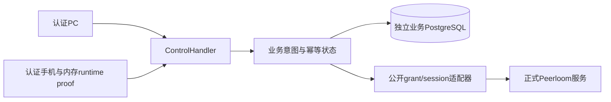

# 控制意图模块

## 边界

`internal/control` 保存业务控制占用；`internal/peerloom.ControlClient` 仅使用正式公开管理HTTP；`internal/httpapi.ControlHandler` 提供共享OpenAPI路由。Peerloom不感知投屏、脚本、运行时证明或占用意图。当前实现不代表PC/Android最终执行门禁、真实P2P媒体或规模已经验收。

## 数据与恢复

- `qm_control_slots` 保存target的唯一活跃intent和递增业务代次；free通过没有活跃引用表示。
- `qm_control_intents` 保存reserving/active/draining/released/failed、上游结果、grant/session关联、固定runtime boot/hash、撤销证据和释放challenge。
- `qm_control_commands` 保存scope+principal+operation+command的摘要与intent关联，不含token/请求正文。终态24h后返回UNKNOWN，紧凑记录不自动删除，因此旧command不能重新创建授权。数据库空间随操作增长；尚无归档epoch方案。
- 变更使用每服务域短事务锁串行化；所有网络I/O在事务外。该锁仅保护业务事实，不代替Peerloom会话/租约。
- 调用create grant前持久标记dispatched和unknown；本版缺少可信上游重放配置证明，因此每attempt只dispatch一次。超时、进程退出、上游成功但本地未落库均保持unknown/占用；不按源码默认10min/24h盲重发、不换管理凭证域重建。未知grant的自动对账尚未实现，需明确报告，不隐藏为重试成功。
- `Recover`按UUID keyset每批最多100条，返回cursor；不限制设备总数。它恢复未dispatch工作和已知grant撤销，识别目录runtime换代，绝不重发dispatched create。未知grant、新boot且无法取得旧runtime证据时保持draining；没有超时自动free路径。

## 运行时证明

手机每控制运行时生成32字节随机proof，仅内存保留，通过现有status的`runtime_proof`首次登记。业务目录只存hash；同boot重复同seq/body/proof幂等，相同boot换proof拒绝，新boot退休旧boot。旧客户端不带proof仍可上报目录，但create返回RUNTIME_NOT_READY。

create固定当前boot/hash；bind/drained同时匹配固定值与当前目录。proof不在任何目录/intent/current响应返回，不进日志或Peerloom metadata。新进程即使获知旧challenge也不能替旧运行时ACK。此机制防错误运行时接纳，不是对任意客户端代码停止的密码学证明，仍要求手机正确停止旧输入、队列和接入口。

## grant与关闭

默认建连窗口300s（部署可配置1..2592000），使用`no_new_connections`；已有session的有效SDK租约不因该窗口到期被踢掉。原session传输恢复不换grant，bind不会把grant自然到期误当已有session授权失效。新session需要先安全结束旧intent，再创建新的业务操作。

close立即进入draining，显式revoke已知grant；查询确认撤销后才生成手机可见的drain_token。手机ACK必须来自固定runtime；已绑定时session必须匹配，无绑定时省略session，但同样必须证明本代接纳入口已关闭。grant未知时即使手机声称drained也不能释放。PC只看到状态，不能代发ACK；SDK关闭不代表脚本停止，已有脚本继续遵循原规则。

## 验证

普通测试覆盖严格JSON、角色边界、无秘密回显、默认TURN限制及公开HTTP响应/租户/重定向/未知结果。`integration`使用独立`*_test`数据库覆盖并发竞争、服务重建、丢响应、运行时换代、终态过期与代次溢出。正式包测试单列，不用纯HTTP夹具冒充真实Peerloom，更不把权威session申请等同P2P数据面验收。执行命令及环境见部署指南；没有明确测试结果前不声称对应门禁通过。
