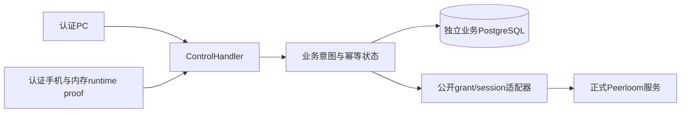
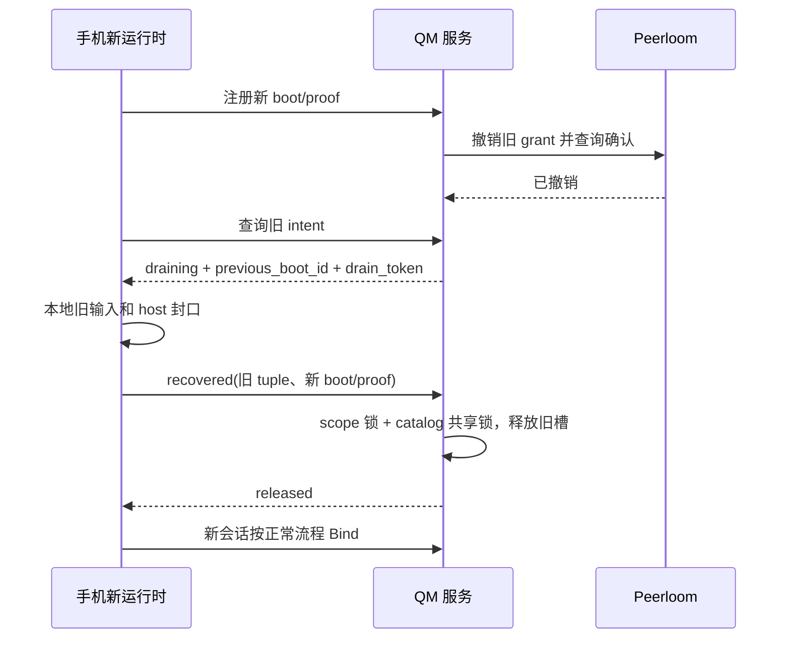

# 控制意图模块

## 边界

`internal/control` 保存业务控制占用；`internal/peerloom.ControlClient` 仅使用正式公开管理HTTP；`internal/httpapi.ControlHandler` 提供共享OpenAPI路由。Peerloom不感知投屏、脚本、运行时证明或占用意图。当前实现不代表PC/Android最终执行门禁、真实P2P媒体或规模已经验收。

## 数据与恢复

- `qm_control_slots` 保存target的唯一活跃intent和递增业务代次；free通过没有活跃引用表示。
- `qm_control_intents` 保存reserving/active/draining/released/failed、上游结果、grant/session关联、固定runtime boot/hash、撤销证据和释放challenge。
- `qm_control_commands` 保存scope+principal+operation+command的摘要与intent关联，不含token/请求正文。终态24h后返回UNKNOWN，紧凑记录不自动删除，因此旧command不能重新创建授权。数据库空间随操作增长；尚无归档epoch方案。
- 变更使用每服务域短事务锁串行化；所有网络I/O在事务外。该锁仅保护业务事实，不代替Peerloom会话/租约。
- 调用create grant前持久标记dispatched和unknown；本版缺少可信上游重放配置证明，因此每attempt只dispatch一次。超时、进程退出、上游成功但本地未落库均保持unknown/占用；不按源码默认10min/24h盲重发、不换管理凭证域重建。未知grant的自动对账尚未实现，需明确报告，不隐藏为重试成功。
- `Recover`按UUID keyset每批最多100条，返回cursor；不限制设备总数。它恢复未dispatch工作和已知grant撤销，识别目录runtime换代，绝不重发dispatched create。未知grant、新boot且无法取得旧runtime证据时保持draining；没有超时自动free路径。

## 绑定约束与解绑恢复

意图固定 `binding_id` 与 `binding_revision`。create、grant签发后回写、手机session绑定/接受和恢复必须核验关系仍有效。解绑同事务标记关系撤销并写入关闭outbox；恢复器复用原grant撤销/drain，不因重绑复活旧意图。关闭原因 `unbound` 仅由服务产生，客户端close原因仍为原枚举。

关系撤销后不再发新业务授权；若上游撤销尚未确认，持续恢复并显示关闭待完成，不承诺单个租约周期必停。已确认撤销但通知丢失与撤销请求未送达分别验收，手机在无法确认授权时关闭输入gate。

## 运行时证明

手机每控制运行时生成32字节随机proof，仅内存保留，通过现有status的`runtime_proof`首次登记。业务目录只存hash；同boot重复同seq/body/proof幂等，相同boot换proof拒绝，新boot退休旧boot。旧客户端不带proof仍可上报目录，但create返回RUNTIME_NOT_READY。

create 固定当前 boot/hash；bind/drained 同时匹配固定值与当前目录。mobile 响应提供 previous_boot_id，PC 响应不包含此字段。proof不在任何目录/intent/current响应返回，不进日志或Peerloom metadata。新进程即使获知旧challenge也不能替旧运行时ACK。此机制防错误运行时接纳，不是对任意客户端代码停止的密码学证明，仍要求手机正确停止旧输入、队列和接入口。

## grant与关闭

默认建连窗口300s（部署可配置1..2592000），使用`no_new_connections`；已有session的有效SDK租约不因该窗口到期被踢掉。原session传输恢复不换grant，bind不会把grant自然到期误当已有session授权失效。新session需要先安全结束旧intent，再创建新的业务操作。

close立即进入draining，显式revoke已知grant；查询确认撤销后才生成手机可见的drain_token。手机ACK必须来自固定runtime；已绑定时session必须匹配，无绑定时省略session，但同样必须证明本代接纳入口已关闭。grant未知时即使手机声称drained也不能释放。PC只看到状态，不能代发ACK；SDK关闭不代表脚本停止，已有脚本继续遵循原规则。

## 验证

普通测试覆盖严格JSON、角色边界、无秘密回显、默认TURN限制及公开HTTP响应/租户/重定向/未知结果。`integration`使用独立`*_test`数据库覆盖并发竞争、服务重建、丢响应、运行时换代、终态过期与代次溢出。正式包测试单列，不用纯HTTP夹具冒充真实Peerloom，更不把权威session申请等同P2P数据面验收。执行命令及环境见部署指南；没有明确测试结果前不声称对应门禁通过。

### 未绑定旧运行时的安全回收

当意图尚未完成 bind（持久化 session_id 为空）、手机已登记不同的 runtime boot/proof 且该意图进入 draining 时，恢复扫描通过 Peerloom 公开接口重新确认同租户、同 PC/手机的原 grant 已撤销；随后在与 Bind 相同的业务 scope 锁内重读状态、grant、双方、session 与当前 runtime，满足全部条件才释放槽位。手机只有 bind 的 active/confirmed 响应或对账证据后才能 accept 并创建执行 context，因此该路径没有已授权执行器需要旧 ACK；迟到 Bind 只能被 closing/terminal 门禁拒绝。不同 runtime 本身不是旧资源排空证明。

该路径不依赖固定超时、不伪造 drained、不改旧 proof，也不清数据库。原 grant 未知、查询失败、撤销未确认、身份不匹配均保持占用并由后续有界扫描重试；已经 bind 的会话仍必须走原运行时的真实排空确认，不能因 boot 变化或 transport 关闭而放行。故此修复解决的是未 bind 时客户端崩溃/替换造成的占用，不宣称解决所有已绑定执行器崩溃。

## 已绑定会话重启恢复

手机新运行时注册后，旧意图进入 draining，服务端撤销并确认旧 grant，才返回 drain_token。新运行时必须先关闭旧的本地输入入口、队列和续帧回调；同进程重建等待原 host 退出，新进程不重放旧命令。随后向 `POST /qm/v1/device-self/session-intents/{id}/recovered` 提交原 `business_generation/session_id/drain_token`、新的 `boot_id/runtime_proof` 和幂等 `command_id`。

服务端校验认证手机、原意图完整 tuple、已验证撤销及新 boot 与当前目录 proof。catalog 的共享行锁保持到释放事务提交，避免检查后切换运行时。新 boot 必须不同于原意图 boot；session 必须非空。普通 drained 的原运行时校验不变，不允许借 recovered 省略正常停止流程。重试只返回原意图终态，不会清除后来创建的槽位；更换请求体沿用 command_id 被拒绝。

recovered 表示旧软件执行器不再提交命令，不表示已经交给 Android 的触点、导航或 IME 副作用完成。手机崩溃后的旧物理触点不作为恢复前置条件。不新增 epoch、心跳或超时强制释放协议，不修改持久绑定关系。

服务端与支持 recovered 的 Android 候选成套验证后部署；旧客户端只会保守阻止恢复，不能把其失败当作已完成。所有测试使用隔离 *_test 数据库及随机 schema，不能对开发现场业务库运行集成测试。
