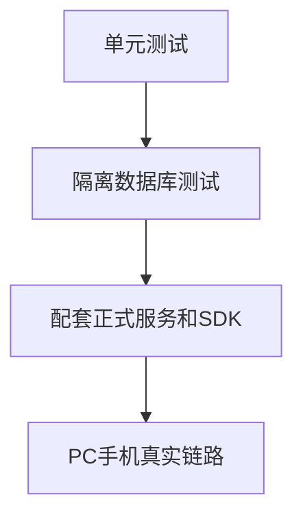

# 现状核对与需求追踪

身份与持久绑定以 qm-app 6279dfe 的规格为准。本文描述服务端实现边界，不把旧版本静态核对、历史PR或其他仓的旧真机测试当作本次验收。

| 需求 | 当前服务端实现 | 仍需独立证据 |
|---|---|---|
| 长期安装认证 | 直接公开device-self，每请求权威核验，无exchange/access模块 | 正式Peerloom及SDK长期离线、撤销与安全存储 |
| 双向绑定 | ensure、六位码、单项/批量、手机唯一PC、列表分页 | 两端UI入口和真实离线恢复 |
| 刷新/解绑 | 手机未绑定可刷新；退休码不复用；解绑保留当前码 | 真机入口、取消与重复操作 |
| 在线 | 对绑定对端公开GetDevice，有界并发，失败为null未知 | 真实心跳TTL与前后台同步 |
| 控制 | 固定关系版本；grant竞态复核；durable outbox、撤销和drain | 配套SDK、实际输入gate、丢通知与网络恢复 |
| 发布 | workflow构建服务验证产物 | 精确提交CI、正式发布版本与校验和、PC/手机联调 |

各阶段证据不能互相替代。Core媒体TCP桥和无关功能不在本次范围；不自动清现场数据库或迁移旧本地UUID记录。不增加新产品入口，额外功能先与用户确认。
