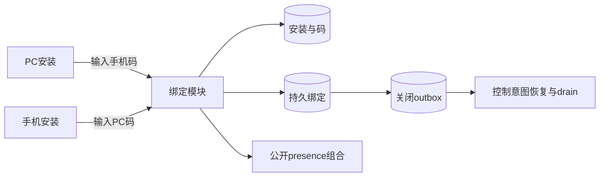

# 持久绑定模块

`internal/binding` 拥有业务安装、六位码、持久关系和关系关闭 outbox；不拥有 Peerloom 身份秘密、网络会话或设备 presence。客户端以安装凭据逐请求认证，主体由可信 tenant/application 映射确定。

## 码与关系

码是保留前导零的六位字符串，CSPRNG 均匀采样，数据库在同一 service scope 对 PC/手机共用码空间。PC 码固定；未绑定手机可手动刷新，绑定后不展示码且服务端拒绝刷新。解绑恢复原当前码，不自动换码。退休码永久不分配给任何安装，每域最多一百万个取值；耗尽返回 `CODE_SPACE_EXHAUSTED`。单次最多64次碰撞尝试，尚未耗尽但本轮分配失败返回 `CODE_ALLOCATION_RETRY`，不无限循环或偷偷扩位。

PC 可绑定多台手机；数据库部分唯一索引限制每手机最多一条 active 关系。相同配对重复请求返回已有关系，其他 PC 不能抢绑。绑定不要求对端在线。解绑后再绑定产生新 `binding_id`，旧解绑请求不能解除新关系。内部 UUID 不作为 UI 添加入口或可见绑定码。

六位长期码没有新增限流、锁定或审批，存在枚举和抢先绑定风险，这是当前明确接受的开发边界，不是高强度秘密。数据库持有码用于重复展示，限制数据库访问；不得写明文日志、analytics 或提交测试现场码。

## 事务与恢复

全部关系变更先取 `qm-control:<scope>` PostgreSQL advisory transaction lock，与控制事务统一，再访问安装/关系/码记录。独立业务事务不跨网络。数据库唯一约束是最后防线；刷新与绑定、双 PC 抢绑只能按提交顺序决定赢家。

解绑校验成员身份及 `expected_revision`，同事务标记 revoked、版本递增并写入 `qm_binding_close_tasks`。接口 `close_pending` 区分关系已解除和执行资源仍在关闭。控制模块通过 `PendingClosures` / `CompleteClosure` 访问 outbox；服务重启继续撤销和排空，外部失败不重新激活关系。

请求键按 scope/调用者/操作隔离，摘要校验同键请求一致性。成功响应保留24小时，过期返回 `OUTCOME_UNKNOWN`，键和摘要永久保留为墓碑，不重新执行。变更时有界清理最多200条过期响应正文；墓碑会累计占用数据库空间，当前不自动归档或重用。绑定码退休记录与幂等墓碑不是同一概念。

批量只允许 PC，每批1–200项，各项独立事务；先认证整批并校验关联 ID，再逐项执行。成功项保留，未知项按原 `operation_key` 重试。客户端负责空行清理、重复行反馈和大文件分批，不能把码转整数。完整路由、请求和错误见 [绑定 OpenAPI](../api/binding.openapi.json)。

## 在线与控制边界

绑定列表是关系权威来源；Peerloom 公开 `GET /v1/devices/{id}` 的 presence 与之独立。`online=null` 表示未知，不清空绑定或断言离线。设备显示名称可来自上游 metadata，客户端本地备注优先；不以 UUID 作为用户添加入口。前台约5秒有界轮询是客户端接入目标，不是服务端推送或瞬时离线检测保证。

控制意图固定关系 ID/版本；grant 签发前后、手机接受和恢复都需有效关系。解绑后拒绝新业务授权，旧资源按原 drain 协议收束；Peerloom 撤销尚未成功时不能承诺一个租约周期内必然停止。手机必须在关系无效或无法确认时关闭输入 gate。停止投屏/断开会话与解绑不同，前两者保留关系。

## 验证边界

本模块真实隔离 PostgreSQL 测试覆盖前导零、幂等初始化、双向/重复绑定、手机唯一 PC、PC 多手机分页、两 PC 竞争、刷新/绑定竞争、退休码失效、百万码空间耗尽、旧解绑隔离、receipt 过期及 outbox 完成回查。测试不代表正式发布包、PC/Android 接线或真机投屏/控制已通过。

关闭任务查询按最近检查时间公平轮转，每次最多100条。长期未知/排空中的前页不会饿死后续任务；只有关联旧控制全部终态才标记关闭完成。
