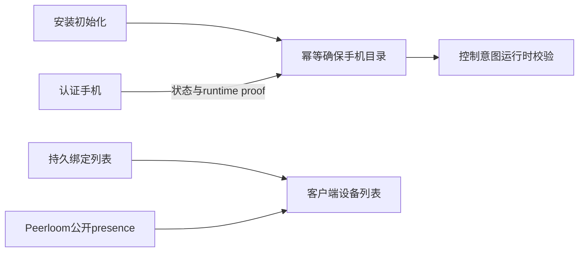

# 设备目录模块

`internal/catalog` 保存手机能力、权限与运行时快照，不拥有持久绑定和在线状态，也不再提供按任意 UUID 查询/添加的公开入口。

目录主键为 `service_scope + device_uuid`；主体由直接安装认证决定，正文不能伪造目标 UUID 或应用。初始化 `EnsureRegistration` 仅为新安装创建空记录，重复调用保留版本、boot、序号、权限、能力及时间，不视作上线心跳。

手机本人调用 `PUT /qm/v1/device-self/status` 提交完整权限能力快照。同 boot 序号递增，重复同序号同内容幂等；已退休 boot 的延迟包不能覆盖新运行时。没有录屏权限仍可登记与上报，但不能据此宣称能投屏。runtime proof 仅存哈希，不在公开列表或 intent 中回显。

关系来源为 [绑定模块](绑定模块.md)，PC 只列出自己的有效关系，不再通过 `/devices/resolve` 绕过授权枚举 UUID。在线状态来自 Peerloom 公开 presence；状态快照、绑定存在与控制占用各自独立。不可达保留关系并标记未知，不把所有手机判断为离线。

目录迁移仍由部署入口显式执行。单元、独立 PostgreSQL 及 HTTP 测试与两端真机验收分别报告，历史目录测试不代表新增绑定交互已完成。

导航能力 `navigation_v1.actions` 可选，允许六项 `back/home/recents/volume_up/volume_down/notifications`，最多六项且不重复；显式 null、非字符串及未知动作拒绝，其他能力不能携带 actions。旧版省略该字段保持兼容，显式空数组原样保留。状态严格解码后校验，现有 capabilities JSON 存储与目录返回保留该列表，不需要数据库迁移；能力快照不作为在线证明。
