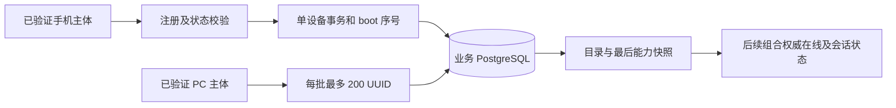

# 设备目录模块

本模块使用独立 PostgreSQL 业务表保存安装实例目录、权限与能力快照。它不访问 Peerloom 私有表，不复制独占锁，也不把 `updated_at`、录屏权限或上次画面当作在线证据。



## 数据一致性

目录主键为 `service_scope + device_uuid`，注册必须来自已验证手机主体。身份来自凭证，不接受客户端在状态正文中指定目标 UUID。安装实例的 application 不可通过再次注册更换；PC 不能注册手机记录。

状态更新使用 PostgreSQL 行锁串行处理同一设备。当前 boot 的 seq 只能递增；新 boot 清除序号基线，已退役 boot 的迟到消息明确返回 STALE_STATUS。状态更新与 boot 记录同一事务提交，失败不留下部分状态。能力的 available=true 必须同时 supported=true。

查询只允许同产品租户的已验证 PC，按服务域隔离。无效 UUID 按项返回，重复输入保留对应结果，未注册和已注册但缺权限相区分。单批 200 是请求体边界；调用方持续分批可处理 501 及更多设备，目录本身没有台数配额。这里返回最后权限快照，HTTP 层仍须组合 Peerloom 权威在线状态，离线时不得显示可操作。

## 自测

```sh
go test -race ./...
QM_TEST_DATABASE_URL='postgres://…/quickmirror_test' go test -race -tags integration ./internal/catalog
```

集成测试必须显式提供独立名称以 `_test` 结尾的数据库，未配置即失败，不跳过后宣称通过。每项测试创建随机隔离 schema 并清理，测试迁移重复执行、角色和服务域隔离、退役 boot、100 个并发状态更新，以及 501 条记录分批查询。GitHub CI 使用临时 PostgreSQL 18 服务；测试密码仅用于该临时容器，不能用于部署。

数据库记录测试不等于 501 个真实 PeerConnection，更不等于 501 台手机投屏。目录 HTTP 尚未对运行时开放，Redis 状态推送与完整部署集成也未完成。

## HTTP 边界（未挂运行时）

`httpapi.CatalogHandler` 使用单独的 `AccessVerifier.VerifyAccess`，不能把安装凭证的 `Verify` 误当业务token验证。生产exchange/可信期限adapter未完成，当前最小进程没有挂载这些路径；没有mock放行开关。

- POST `/qm/v1/devices/resolve`：仅PC，逐项返回UUID规范化/存在性/非法项错误。当前仅实现存在性结果，不把旧permissions/capabilities当当前可操作状态；状态revision、在线查询和WSS增量仍未实现。
- PUT `/qm/v1/device-self/status`：仅手机本人，由验证后的主体决定UUID；拒绝请求体伪造device_uuid。完整替换权限/能力快照，不等于认证心跳或会话续租。调用前目录必须已通过可信安装注册登记。
- 严格拒绝多Authorization、未知/重复JSON字段、无效UTF-8、查询参数、多个JSON值、超过1MiB正文或过深/过多JSON节点。身份先验证，错误不泄露凭证、数据库或上游内部信息。
- 在途请求预算与10秒操作期限是资源保护，不是设备台数上限。每批最多200项；501条记录经过200/200/101三批真实TLS+PostgreSQL请求测试，均保留，不能把批次上限显示为产品台数上限。

字段及局部实现范围见 [目录OpenAPI](../api/catalog.openapi.json)。测试中的AccessVerifier为明示夹具，只验证HTTP/目录接缝，不冒充真实Peerloom身份链路或在线会话。

自定义嵌套JSON扫描器另有Go原生fuzz入口，覆盖无效UTF-8、重复键、深度/节点预算和标准JSON值语义；普通CI运行种子回归，定向压力验证可运行：

```sh
go test -run '^$' -fuzz '^FuzzStrictObjectDecoder$' -fuzztime=30s -parallel=1 ./internal/httpapi
```

该测试只验证解析边界，不代表网络、Peerloom或设备规模性能。
