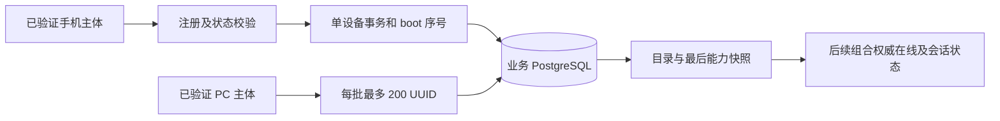

# 设备目录模块

本模块使用独立 PostgreSQL 业务表保存安装实例目录、权限与能力快照。它不访问 Peerloom 私有表，不复制独占锁，也不把 `updated_at`、录屏权限或上次画面当作在线证据。



## 数据一致性

目录主键为 `service_scope + device_uuid`，注册必须来自已验证手机主体。身份来自凭证，不接受客户端在状态正文中指定目标 UUID。安装实例的 application 不可通过再次注册更换；PC 不能注册手机记录。

状态更新使用 PostgreSQL 行锁串行处理同一设备。当前 boot 的 seq 只能递增；新 boot 清除序号基线，已退役 boot 的迟到消息明确返回 STALE_STATUS。状态更新与 boot 记录同一事务提交，失败不留下部分状态。能力的 available=true 必须同时 supported=true。

查询只允许同产品租户的已验证 PC，按服务域隔离。无效 UUID 按项返回，重复输入保留对应结果，未注册和已注册但缺权限相区分。单批 200 是请求体边界；调用方持续分批可处理 501 及更多设备，目录本身没有台数配额。这里返回最后权限快照，HTTP 层仍须组合 Peerloom 权威在线状态，离线时不得显示可操作。

## 自测

```sh
go test -race ./...
QM_TEST_DATABASE_URL='postgres://…/quickmirror_test' go test -race -tags integration ./internal/catalog
```

集成测试必须显式提供独立名称以 `_test` 结尾的数据库，未配置即失败，不跳过后宣称通过。每项测试创建随机隔离 schema 并清理，测试迁移重复执行、角色和服务域隔离、退役 boot、100 个并发状态更新，以及 501 条记录分批查询。GitHub CI 使用临时 PostgreSQL 18 服务；测试密码仅用于该临时容器，不能用于部署。

数据库记录测试不等于 501 个真实 PeerConnection，更不等于 501 台手机投屏。本模块尚未提供外部 HTTP、Redis 状态推送或部署入口；这些依赖后续服务集成。
