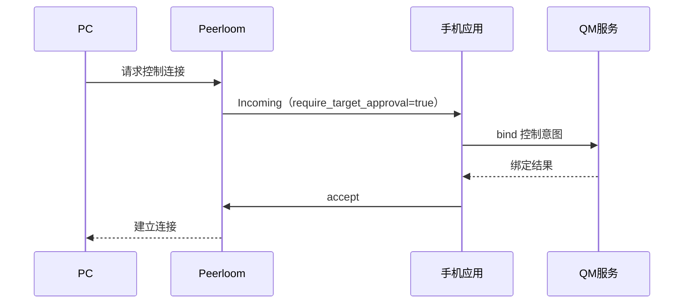

# 部署指南

当前进程提供安装注册 bootstrap、直接安装认证、持久绑定与设备目录 HTTP；控制意图HTTP已接入，需手机 runtime 登记；正常关闭用原运行时 drained，崩溃恢复用新运行时 recovered 确认本地旧输入封口后释放；在线采用公开presence组合；自建TURN编排不由本次改造交付。它不是已完成的群控服务，不应把验证分支产物直接视为生产发行版。本次开发没有执行外部生产部署。

## 环境边界

- 独立 PostgreSQL 业务数据库，使用 SCRAM 认证及 `sslmode=verify-full`，由数据库角色限制权限；不读取 Peerloom 私有表。
- HTTPS 服务端证书和私钥。最低 TLS1.2，以兼容 Android8；数据库和上游 Peerloom TLS 验证不能关闭。
- Peerloom 必须是配套长期安装身份版本：公开 `device-self` 返回权威设备、应用和租户，不再要求凭据期限字段；SDK ABI 为2。正式发布版本与校验和应以聚合仓锁文件及实际成功发布为准，不能消费旧 ABI1 产物冒充升级。固定租户、两个不同的 PC/mobile application、注册模式 `grant` 或 `both` 以及仅驻留服务端的管理凭据。
- 本服务没有源码子模块依赖。无需克隆 PC/Android/Peerloom 源码即可构建这个 Go 服务；完整项目请使用 qm-app 聚合仓库。

## PC / 手机应用初始化契约

QM 的两个应用不是同一策略：PC 保持 `require_target_approval=false`；**手机必须为 `true`**。手机的 `Incoming` 事件触发业务 `bind`，之后才接受连接；若手机应用为 `false`，SDK 直接进入 connecting 会绕过这一步。该要求属于 QM，不能修改 Peerloom 通用 setup 默认值来代替。



完成 Peerloom 租户和服务凭据初始化后，使用本仓标准库 Python 工具创建应用。不额外创建租户或服务凭据，不在服务器启动时自动改策略。凭据文件使用 setup 输出的私有 JSON（`service_credential`）；文件及父目录仅供运维/服务账号读取。命令不会打印凭据或上游响应正文。

```sh
# 每个角色使用一个独立、固定的 UUID；首次生成后保存，失败重试必须复用原 UUID 和所有参数。
python3 scripts/init-peerloom-application.py --origin "$PEERLOOM_ORIGIN" \
  --credential-file /private/connection.json --tenant "$TENANT_ID" \
  --role pc --name QM-PC --operation-id "$PC_OPERATION_ID"
python3 scripts/init-peerloom-application.py --origin "$PEERLOOM_ORIGIN" \
  --credential-file /private/connection.json --tenant "$TENANT_ID" \
  --role mobile --name QM-Mobile --operation-id "$MOBILE_OPERATION_ID"
# 已有应用仅检查；可省略name，但不会按同名认领、更新、删除或创建替代应用。
python3 scripts/init-peerloom-application.py --origin "$PEERLOOM_ORIGIN" \
  --credential-file /private/connection.json --tenant "$TENANT_ID" \
  --role mobile --existing-id "$QM_MOBILE_APPLICATION_ID"
```

将输出 ID 分别配置为 `QM_PC_APPLICATION_ID` 和 `QM_MOBILE_APPLICATION_ID`。工具只接受 HTTPS，验证系统 CA（私有 CA 用 `--ca-file`），拒绝重定向；创建请求固定 `registration_mode=grant`，同操作 ID 复用完全相同的请求。创建或重放后再次 GET 检查当前状态，已有应用检查覆盖租户、ID、enabled、注册模式和审批策略（提供 name 时也核对名称）。策略不符只报告 `APPLICATION_POLICY_MISMATCH`，不会 PATCH；须经运维明确授权另行修改。不要为绕过幂等冲突更换操作 ID，也不要用本工具修复已有应用。已有租户/应用数据及 PC 策略不受失败重试影响。已有 PC 若为 `require_target_approval=true`，只报告不匹配，由部署者另行决定是否保留；不能为修复手机 Incoming 问题顺手改动 PC 策略。

## 配置

通过受控环境配置注入，不把数据库密码、管理密钥或私钥提交到 Git，也不要粘贴到对话或日志。

| 环境变量 | 内容 |
|---|---|
| QM_DATABASE_URL | PostgreSQL DSN，必须 verify-full，可指定受信 CA 的 sslrootcert |
| QM_SERVICE_SCOPE | 固定业务服务 UUID |
| QM_TENANT_ID | Peerloom 租户 UUID |
| QM_PC_APPLICATION_ID / QM_MOBILE_APPLICATION_ID | 两个不同的安装 application UUID |
| QM_PEERLOOM_ORIGIN | 固定 HTTPS origin，无 path/query/fragment |
| QM_PEERLOOM_SERVICE_CREDENTIAL | 仅服务端使用的管理凭证 |
| QM_CONTROL_GRANT_TTL_SECONDS | 新session建连窗口秒数，默认300，允许1..2592000；no_new_connections，不是既有控制会话时长上限 |
| QM_API_CONCURRENCY | 绑定、目录与控制的最大在途请求，默认64，允许1..4096 |
| QM_TLS_CERT_FILE / QM_TLS_KEY_FILE | 服务 HTTPS 证书和私钥路径 |
| QM_LISTEN_ADDRESS | 默认 127.0.0.1:8443；外部监听需部署者明确配置和访问控制 |
| QM_BOOTSTRAP_CONCURRENCY | 匿名注册最大在途请求，默认16 |
| QM_BOOTSTRAP_BURST / QM_BOOTSTRAP_RATE | 进程级令牌桶容量/每秒补充，默认20/2 |

这些资源预算只限制瞬时HTTP负载，不限制已经注册或可连接的设备数量。多实例还需要受控统一入口限流；不要把 X-Forwarded-For 当可信身份。数据库连接池目前最大16连接，按查询复用，不是一台设备对应一个连接。

## 构建和启动

```sh
go build -trimpath -o quick-mirror-service ./cmd/quick-mirror-service
# 配置已经通过受控环境注入后，显式迁移；普通 HTTP 请求不修改 schema。
./quick-mirror-service -migrate
# TLS-only 监听；Ctrl-C/SIGTERM 优雅结束正在处理的请求并关闭连接池。
./quick-mirror-service
```

服务设置请求头5秒、读取10秒、写入15秒和空闲60秒边界，最大请求头16KiB；退出最多等待10秒。启动错误只打印稳定类别，不打印 DSN/秘密/原始上游错误。证书和私钥须由服务账号独占读取。不存在业务 token 密钥或来源凭据密文库，不再配置专用业务加密预算。

迁移角色可与运行角色分离。显式 `-migrate` 创建目录、注册、绑定和控制表，不自动删除旧 access 表或来源秘密。启动检查若发现旧 `qm_access_tokens` / `qm_access_key_usage` 则拒绝继续，避免静默保留旧认证体系。开发期推荐新建独立数据库并保留旧库备份；现场旧表仅可由运维在明确授权及备份后人工处置，不提供自动 wipe。旧本地 UUID 列表也不能猜测归属迁成服务端绑定。

bootstrap 收据按原策略清理；绑定响应正文保留24小时并在变更时有界清理，绑定操作键/摘要墓碑及退休码不自动删除。控制命令墓碑与未知占用不按超时清空。六位码空间永久不复用最多一百万；无新增尝试限流或审批，有枚举/抢先绑定风险，不能宣称是高强度认证。

## 验证和产物

三平台 CI 执行普通 race/vet/build、编译运行期集成测试，并产出各自平台的服务验证二进制；它不是正式签名或自动发布。PostgreSQL集成作业覆盖目录、bootstrap意图、binding与HTTP模块。运行期 TLS+真实数据库测试用独立 `runtimeintegration` 标签，需要专用 `*_test` 数据库与 verify-full CA 配置；不能对生产数据库运行测试。

```sh
go test -race ./...
go test -race -tags integration ./internal/catalog ./internal/bootstrap ./internal/binding ./internal/httpapi ./internal/control
go test -race -tags runtimeintegration ./cmd/quick-mirror-service
```

后两条分别使用 `QM_TEST_DATABASE_URL` 与 `QM_RUNTIME_TEST_DATABASE_URL`。旧正式包验收不覆盖新长期身份和持久绑定；当前 Go/PG 单元及集成通过不代表正式 SDK/两端客户端或真机控制完成。部署之前核对该提交实际门禁及配套发布包，不自动部署到现有服务器。

## 验证与提交门禁

CI 对 master、qm-app 与 codex/** 代码推送执行三平台 race/vet/build、数据库集成和构建产物；也支持 workflow_dispatch。仅文档改动不触发矩阵。实际成功必须对应推送的精确 SHA，不能以祖先或不同提交的检查替代。聚合仓只更新已推送可获取的子仓指针；本地通过不等于远端 CI 或真实设备链路通过。

## 云端源码双服务隔离测试

`scripts/test-source-services.py` 使用真实 Peerloom/QM **源码编译二进制**、真实 PostgreSQL 与 Redis，经临时透明 TLS 反代调用公开 API。它不是正式 SDK 发布包、媒体、PC/Android UI 或真机验收，也不模拟跨年时钟。测试不接受外部服务器 URL、现有数据库 DSN 或管理凭据。

前置条件：Linux 非 root 用户、Python 3、OpenSSL、Go、PostgreSQL `initdb/pg_ctl/createdb`、Redis。工具来源须为已信任发行包。先审核并固定 Peerloom 与 QM 的提交，确保传入的 Peerloom migration 与编译产物属于同一源码版本。例如在本仓根目录：

```sh
PEERLOOM_ROOT="$(realpath ../peerloom)"
BIN="$(mktemp -d)"
# 当前本仓和相邻Peerloom源码分别编译；输出只是本地验证产物。
go build -o "$BIN/quick-mirror-service" ./cmd/quick-mirror-service
(cd "$PEERLOOM_ROOT/src/device-server" &&
  for tool in device-server device-admin device-migrate; do
    go build -o "$BIN/$tool" "./cmd/$tool" || exit 1
  done)
python3 scripts/test-source-services.py \
  --peerloom-root "$PEERLOOM_ROOT" --peerloom-bin "$BIN" \
  --qm-bin "$BIN/quick-mirror-service" \
  --postgres-bin /usr/lib/postgresql/17/bin \
  --redis-bin "$(command -v redis-server)" --go "$(command -v go)"
# 可记录测试所用的二进制校验和，但不能将本地产物当成正式release。
sha256sum "$BIN/device-server" "$BIN/quick-mirror-service"
```

`--postgres-bin` 按已安装版本调整；`--library-path` 可传隔离工具链动态库目录，`--openssl` 可指定二进制，`--port-base` 默认55800，仅使用loopback连续5个端口。端口占用立即失败，不连接或关闭已有服务。脚本保留 `redis-server` 符号链接名称，因为部分发行包通过进程名选择 server/tool 模式。

运行会新建权限受限的临时目录、全新 PostgreSQL 集群和两个测试数据库，使用临时自签证书并显式验证，不修改系统信任库；PostgreSQL的trust认证只用于该临时loopback测试集群，不是部署建议。Redis秘密、注册凭据、管理凭据和绑定码均临时生成，不打印服务日志或HTTP正文；结束或失败时停止自己的子进程并清理临时目录。不自动删除传入二进制目录，不触碰已有数据库/现场身份。环境中的业务数据库及管理配置会过滤后再启动测试进程。

覆盖：公开注册无凭据期限、直接认证/角色隔离、重复ensure、双向绑定、离线presence、码隐藏与刷新、旧码失效、抢绑拒绝、两端解绑、批量部分成功及原key重放、两个服务重启后的身份/绑定保留、公开撤销拒绝认证、上游停机不伪造空列表。由于需要单独工具链和配套源码，它是显式手动测试入口，不新增每次推送自动运行的跨仓CI矩阵。

## 已绑定崩溃恢复的代理路由部署检查

服务新增恢复确认接口后，所有按路径限制访问的外层和内层代理必须同步放行：

`POST /qm/v1/device-self/session-intents/{intent_id}/recovered`

如果现有规则仅允许同一路径下的 `(bind|drained)`，应在保持 UUID 路径约束、POST 方法和既有后端不变的前提下扩展为 `(bind|drained|recovered)`，不可放开整个管理接口。共享网关变更需要单独协调窗口与授权，备份现有配置、验证语法后平滑重载，其他服务路由保持不变。

部署验收必须对新增接口本身做探针：以合法 UUID 的 intent 路径发送无认证 POST，预期由 QM 返回 HTTP 401、`AUTH_INVALID` 与 UUID `request_id`。网关返回 404 表示路由未接通；仅检查旧接口的 401 不能证明新恢复接口已经可达。该探针不会确认业务恢复成功，完整验收仍需真实已绑定会话在手机进程重启后，以新 boot 登记并提交 recovered，观察旧 intent released、槽位清空、绑定保留，然后重新投屏与正常停止。

本接口不需要新增环境变量或数据库迁移；但代理白名单更新属于必要的部署契约，不能遗漏。保留旧服务程序和代理配置用于回滚，不以清理数据库代替恢复验证。
